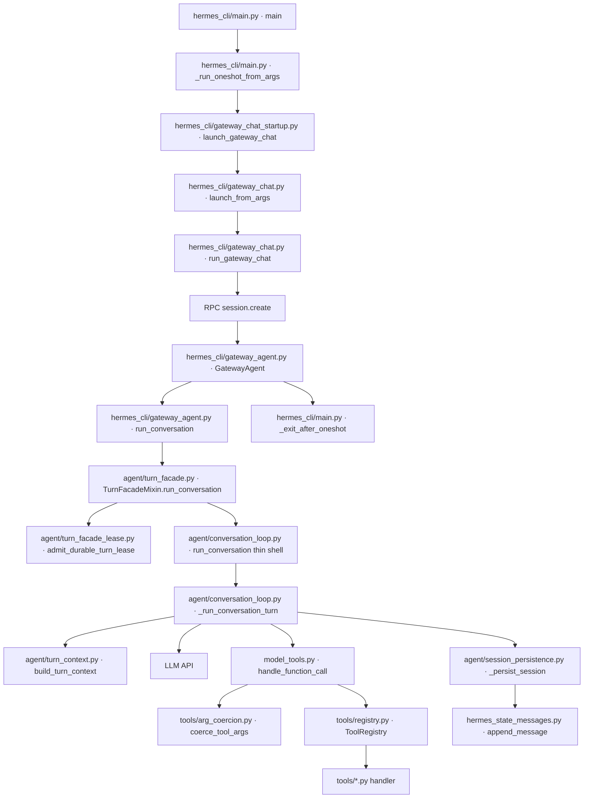

# 03 详细逐步说明：主链路拆解

> 层：第 3 层（详细逐步说明 · 主链路拆解）
> 状态：已按 2658ae13b7 复核
> 复核日期：2026-11-16
> 生成日期：2026-11-16
> 前置阅读：[02-简单例子-全路径走读](./02-简单例子-全路径走读.md)
> 后续阅读：第四层模块文档（[04-核心模块与类型关系](./04-核心模块与类型关系.md) 起）

> **记法约定**：`文件路径` · `符号名` `+N`，`+0` = 定义行，`+N` = 符号体内第 N 行。
> 不使用绝对行号。

## 一、本层目标

第二层（02）已经用 `hermes -z "hello"` 把整条主路径走通。本层把这条链路**逐跳拆开**，讲清每一跳：

- 谁调用谁（调用方 → 被调用方）；
- 参数如何传递、如何消费；
- 返回值如何被处理；
- 状态如何变化；
- 错误如何传播（失败分支只标注去向，不铺开细节）。

本层仍以**主成功路径**为主。失败、重试、压缩、并发、插件钩子、缓存失效等复杂分支标注"第四层展开"，
不在这里铺开。每一跳都给出**调用关系表**（调用方与符号 | 关系 | 被调用方与符号 | 触发与输入 | 返回与后续处理 | 错误副作用）。

### 与上一版的差异（2026-11-16）

1. **主循环的角色关系已核实**：`agent/conversation_loop.py` · `run_conversation` `+0`（thin shell）
   与 `agent/turn_facade.py` · `TurnFacadeMixin.run_conversation` `+0`（turn 准入门面）**两个都存在但角色不同**：
   门面负责 turn 准入（租约、relay、作用域），薄壳负责"跑一轮 + 盖 turn 边界戳"。真实主循环在
   `agent/conversation_loop.py` · `_run_conversation_turn` `+0`。
2. **oneshot 主路径已改走网关**：`-z` 不再进 `cli.py` 的 REPL，而是 `_run_oneshot_from_args` →
   `launch_gateway_chat` → `run_gateway_chat` → 网关 RPC → `GatewayAgent`。
3. **`GatewayAgent` 不直接落库**：`GatewayAgent._persist_session` `+0` / `_ensure_db_session` `+0`
   是返回 `None` 的**桩**（占位替身），真正持久化经网关 RPC 在网关进程内完成。非网关路径才走
   `agent/session_persistence.py` · `SessionPersistenceMixin._persist_session` `+0`。
4. **`SessionDB` 已是 18 个 Mixin 组装**（02 写 16，实为 18，新增 `SessionPruneRewriteMixin` /
   `SessionApiContentMixin` / `SessionCoverageMixin`）。

## 二、主链路总览



> 注意：图上 `I`（turn 门面）与 `K`（薄壳）都叫 `run_conversation`，但**不在同一个文件**。
> 门面在 `agent/turn_facade.py`，薄壳在 `agent/conversation_loop.py`。

## 三、逐跳拆解

### 跳 0：`hermes_cli/main.py` · `main` `+0` → `_run_oneshot_from_args` `+0`

#### 谁调用谁

- `hermes` 启动器脚本（仓库根 `hermes`，模块级 `from hermes_cli.main import main`）调用 `main()`；
- `main()` 完成启动准备后，若 `args.oneshot` 存在，调用 `_run_oneshot_from_args(args)` 并退出。

#### 参数

- `main()` 无显式参数，读 `sys.argv`（如 `["hermes", "-z", "hello"]`）；
- `_run_oneshot_from_args(args)` 接收 argparse `Namespace`，其中 `args.oneshot == "hello"`。

#### 返回值

- `_run_oneshot_from_args` 直接 `sys.exit(launch_gateway_chat(args))`，**不返回**。

#### 状态变化

1. `main()`：`_set_process_title` `+0`、`_warn_if_unsupervised_pid1` `+0`、`_apply_profile_override` `+0`
   （**导入重量级模块前**预解析 `--profile` / `-p`）、自愈清理、`_config_default_interface_early` `+0` /
   `_wants_tui_early` `+0`、构建 parser（`_build_cli_parser` `+0`）、`_parse_cli_args` `+0`、
   `_prepare_agent_startup` `+0`；
2. `args.oneshot` 为真 → 走网关 oneshot 路径。

#### 错误传播

- 启动自愈类操作基本 `try/except` 吞掉；
- 致命错误由子命令或 Python 异常向上传播；
- `_require_tty` `+0`：stdin 非终端时 `exit 1`。

**调用关系表**：

| 调用方与符号 | 关系 | 被调用方与符号 | 触发与输入 | 返回与后续处理 | 错误副作用 |
|---|---|---|---|---|---|
| `hermes` 启动器 | 调用 | `hermes_cli/main.py` · `main` `+0` | 进程启动，`sys.argv=["hermes","-z","hello"]` | 返回后进程结束 | 启动异常向上抛 |
| `main` `+0` | 调用 | `hermes_cli/main.py` · `_run_oneshot_from_args` `+0` | `args.oneshot=="hello"` | 不返回，`sys.exit` | 异常向上抛 |

### 跳 1：`_run_oneshot_from_args` `+0` → `hermes_cli/gateway_chat_startup.py` · `launch_gateway_chat` `+0`

#### 参数

- `launch_gateway_chat(args)` 接收同一 `Namespace`。

#### 返回值

- 不返回（`sys.exit` 包装）。

#### 状态变化 / 错误传播

- `launch_gateway_chat`（48 行薄壳）：`bypass_launch(args)` 检查 `--safe-mode` / `--ignore-user-config`；
  非 bypass 时 `_confirm_startup_expensive_model_override(args)` 确认昂贵模型覆盖；然后调 `launch_from_args`。

**调用关系表**：

| 调用方与符号 | 关系 | 被调用方与符号 | 触发与输入 | 返回与后续处理 | 错误副作用 |
|---|---|---|---|---|---|
| `main.py` · `_run_oneshot_from_args` `+0` | 调用 | `gateway_chat_startup.py` · `launch_gateway_chat` `+0` | `args`（含 oneshot） | 返回值被 `sys.exit` 包住 | 配置/覆盖确认失败中断 |

### 跳 2：`launch_gateway_chat` `+0` → `hermes_cli/gateway_chat.py` · `launch_from_args` `+0`

#### 参数

- `launch_from_args(args)` 接收同一 `Namespace`。

#### 返回值

- 返回退出码 `int`（由 `run_gateway_chat` 的返回值透传）。

#### 状态变化（`launch_from_args` `+0`，该文件 403 行）

1. `validate_options(args)`：拒绝不支持的网关选项（`--image`、`--worktree`、`--run-budget` 等）；
2. `ensure_launch_provider(args)`：确保有可用 provider（首跑守卫）；
3. 提取 `oneshot_prompt = getattr(args, "oneshot", None)`；
4. 调用 `run_gateway_chat(args, emitter=None)` 并返回其退出码。

**调用关系表**：

| 调用方与符号 | 关系 | 被调用方与符号 | 触发与输入 | 返回与后续处理 | 错误副作用 |
|---|---|---|---|---|---|
| `launch_gateway_chat` `+0` | 调用 | `gateway_chat.py` · `launch_from_args` `+0` | `args` | 返回退出码，透传 | 选项非法 / 无 provider 提前退出 |

### 跳 3：`launch_from_args` `+0` → `hermes_cli/gateway_chat.py` · `run_gateway_chat` `+0`

#### 参数

- `run_gateway_chat(args, emitter=None)`：`args` + 可选事件发射器（oneshot 用 `None`）。

#### 返回值

- `int` 退出码。

#### 状态变化（`run_gateway_chat` `+0`，该文件 403 行）

1. 提取 `query = getattr(args, "query", None) or getattr(args, "q", None)`；
2. 若 `oneshot_prompt` 是字符串，`query = oneshot_prompt`；
3. 确定 `oneshot = True`；
4. `async with connect_gateway()` 建立 RPC 连接；
5. `client.rpc("runtime.describe")` 获取网关能力描述；
6. **创建会话**：`client.rpc("session.create", source="oneshot", **policy)`，`policy` 含 `model` /
   `provider` / `toolsets` 等创建标志；
7. 打印会话 ID 到 stderr；
8. 构造 `GatewayChatView(client, snapshot, ...)`，`view.unattended = True`；
9. `await view.run(query, oneshot=True)` 执行对话并返回退出码。

**调用关系表**：

| 调用方与符号 | 关系 | 被调用方与符号 | 触发与输入 | 返回与后续处理 | 错误副作用 |
|---|---|---|---|---|---|
| `launch_from_args` `+0` | 调用 | `gateway_chat.py` · `run_gateway_chat` `+0` | `args, emitter=None` | 返回退出码 | 网关连接失败中断 |
| `run_gateway_chat` `+0` | RPC 调用 | 网关进程 `session.create` | `source="oneshot", model, provider` | 返回 session snapshot | 网关异常向上抛 |
| `run_gateway_chat` `+0` | 调用 | `gateway_chat_view.py` · `GatewayChatView.run` `+0` | `query, oneshot=True` | 返回退出码 | 会话提交失败中断 |

### 跳 4：`GatewayChatView.run` `+0` → 网关 RPC `prompt.submit`

#### 参数

- `view.run(query, oneshot=True)`，`self.quiet = self.quiet or oneshot`，`self.finite = oneshot`。

#### 返回值

- 退出码（`_oneshot_exit_code` 映射）。

#### 状态变化（oneshot 分支）

1. `receipt = await self.submit(query)` 提交用户消息（经 RPC `prompt.submit`）；
2. 等待 admission 完成；
3. 提取最终文本：`text = terminal.get("text") or terminal.get("content") or ""`；
4. 打印文本到 stdout；写 usage 文件（若指定）；
5. 返回退出码。

**调用关系表**：

| 调用方与符号 | 关系 | 被调用方与符号 | 触发与输入 | 返回与后续处理 | 错误副作用 |
|---|---|---|---|---|---|
| `GatewayChatView.run` `+0` | RPC 调用 | 网关进程 `prompt.submit` | `session_id, query` | 返回 admission 收据 | 提交失败中断 |
| `GatewayChatView.run` `+0` | 收帧 | 网关进程推送帧 | — | 收集 terminal 文本 | 断连中断 |

### 跳 5：网关侧 · `hermes_cli/gateway_agent.py` · `GatewayAgent` `+0`

#### 谁调用谁

- 网关进程（`gateway/run.py` · `GatewayRunner`，17 Mixin 组装）在 `session.create` 后绑定 `GatewayAgent`；
- `GatewayAgent` 是 `AIAgent` 的**网关替身**：构造于相同调用点，但通过网关 RPC 运行，不直接驱动本地循环。

#### 关键事实

- `GatewayAgent`（该文件 1522 行）`__init__` `+0` 绑定 `session_id`、装配工具集、设置回调；
- `GatewayAgent.run_conversation` `+0`（1502 行起始）是**网关 RPC 提交**：构造 `_Turn`，调
  `_submit_params` `+0`（674 行）拼参数，`self.connection.call("prompt.submit", **params)` 提交，
  然后 `_pump` `+0`（873 行）收取流式帧。
- `GatewayAgent._persist_session` `+0`（537 行）与 `_ensure_db_session` `+0`（540 行）是**返回 `None` 的桩**——
  网关替身不直接写 SQLite，持久化由网关进程内的真实 agent 完成。

**调用关系表**：

| 调用方与符号 | 关系 | 被调用方与符号 | 触发与输入 | 返回与后续处理 | 错误副作用 |
|---|---|---|---|---|---|
| `GatewayRunner`（`gateway/run.py`） | 实例化 | `gateway_agent.py` · `GatewayAgent` `+0` | `session_id, ...` | 得到代理实例 | 装配失败中断 |
| `GatewayAgent.run_conversation` `+0` | 调用 | `_submit_params` `+0` | `user_message, persist_user_message, turn_author` | 返回 RPC 参数字典 | — |
| `GatewayAgent.run_conversation` `+0` | RPC 调用 | `prompt.submit` | `params + session_id` | 返回收据 dict | `GatewayRPCError` / `CallStopped` 分类返回 |

> 网关替身路径与第 02 篇的时序一致。**直接本地循环路径**（非网关，如 `run_agent.py` 直接构造
> `AIAgent` 后调 `run_conversation`）则跳过网关，直接从 `AIAgent` 的 MRO 进入 `TurnFacadeMixin.run_conversation`。

### 跳 6：`agent/turn_facade.py` · `TurnFacadeMixin.run_conversation` `+0`（turn 准入门面）

#### 谁调用谁

- `AIAgent.run_conversation` 经 MRO 从 `TurnFacadeMixin` 继承（**符号不在 `run_agent.py`**）；
- 网关替身路径由网关进程内真实 agent 调用；非网关路径由调用方直接调 `AIAgent.run_conversation`。

#### 参数

```python
run_conversation(
    self, user_message, system_message=None, conversation_history=None, task_id=None,
    stream_callback=None, persist_user_message=None, persist_user_timestamp=None,
    persist_user_display_kind=None, persist_user_display_metadata=None,
    persist_user_platform_id=None, moa_config=None, turn_author=None, relay_metadata=None,
    title_user_message=None, prelude=None,
) -> dict[str, Any]
```

#### 返回值

- `dict`，至少含 `final_response`。

#### 状态变化（turn 准入，本版大幅扩展，该文件 224 行）

1. `cancel_background_review_for_live_turn(self)`：review 与 live turn 共享 session_id（缓存一致性），
   必须先取消或等其退出；
2. 生成 `effective_task_id`、`relay_turn_id`，写 `self._relay_pending_turn_id`；
3. 组装 `task_context = {session_id, task_id, platform}`；`platform == "subagent"` 时带 `relay_parent_session_id`；
4. `admit_durable_turn_lease(...)`（`agent/turn_facade_lease.py` · `admit_durable_turn_lease` `+0`，299 行）：
   申请跨进程持久化租约。**返回 `early_result` 时提前返回**，并用 `carry_unadmitted_user_message` 把
   用户消息带出避免丢失；
5. `relay_runtime.SESSION_COORDINATOR.acquire_conversation(...)` 申请 relay 会话租约；
6. `begin_turn(...)` + `start_task_run(...)`（后者仅在 `relay_turn.relay_enabled` 时）；
7. 设置三个 ContextVar：会话上下文、亲和作用域、计量上下文（`set_accounting_context`）——
   **计量上下文的引入是为了让辅助调用（压缩、vision、MoA）的 token 消耗也能记入 `session_model_usage`**；
8. 在 `bind_subagent_parent(self)` + `scoped_runtime_main({})` + `track_in_interrupt_scope(self)` 内：
   `lease.start()` → 调用跳 8（`agent/conversation_loop.py` · `run_conversation`）；
9. `finally` 清理顺序（**不可颠倒**）：`stop_refresher()` → `join_threads()` →
   `clear_interrupt()`（必须在 join 之后）→ `release()`；随后重置各 ContextVar、
   `_reset_activity_labels_after_turn()`、`_review_queue.note_turn_finished()`。

#### 错误传播

- `BaseException` 捕获后分类 `relay_outcome`（`cancelled` / `timed_out` / `failed`），
  结束 relay 逻辑轮次与计量后**原样 raise**；
- 租约相关的 fail-closed 语义见 [11-并发模型与生命周期](./11-并发模型与生命周期.md)。

**调用关系表**：

| 调用方与符号 | 关系 | 被调用方与符号 | 触发与输入 | 返回与后续处理 | 错误副作用 |
|---|---|---|---|---|---|
| `AIAgent.run_conversation`（经 MRO） | 调用 | `turn_facade.py` · `TurnFacadeMixin.run_conversation` `+0` | 用户消息等全部参数 | 返回结果 dict | `BaseException` 分类后原样 raise |
| `TurnFacadeMixin.run_conversation` `+0` | 调用 | `turn_facade_lease.py` · `admit_durable_turn_lease` `+0` | `session_id, relay_turn_id, task_context, conversation_history` | 返回 `admission(lease, conversation_history, early_result)` | early_result 时提前返回 |
| `TurnFacadeMixin.run_conversation` `+0` | 调用 | `conversation_loop.py` · `run_conversation` `+0` | `self, user_message, ..., turn_author, ...` | 返回结果 dict | 异常在 finally 清理后传播 |

### 跳 7：`agent/conversation_loop.py` · `run_conversation` `+0`（thin shell）与 `_run_conversation_turn` `+0`（实现）

#### 谁调用谁

- `TurnFacadeMixin.run_conversation` 调用 `agent.conversation_loop.run_conversation`；
- 薄壳把实际工作交给同文件的 `_run_conversation_turn`。

#### 参数

- `run_conversation(agent, user_message, system_message=None, conversation_history=None, task_id=None,
  stream_callback=None, persist_user_message=None, persist_user_timestamp=None, persist_user_display_kind=None,
  persist_user_display_metadata=None, persist_user_platform_id=None, moa_config=None, turn_author=None,
  title_user_message=None, prelude=None) -> dict[str, Any]`。

#### 返回值

- `dict`，包含 `final_response`、`messages` 等；薄壳在返回前盖 `user_intervened`。

#### 状态变化

`run_conversation` 薄壳只做四件事（源码 docstring 明确）：

1. `agent._turn_user_intervened = False`；
2. 在 `native_turn_images(user_message)` 上下文内调用 `_run_conversation_turn(...)`
   ——本轮原生附带的图片在 turn 内对 `vision_analyze` 保持可见，避免同一批像素被二次嵌入同一请求；
3. `fence_result_reply(result)`、`lead_failed_turn_with_primary_auth`、`settle_held_final(agent, result)`；
4. `export_current_turn_boundary(agent, result, user_message)` `+0`
   （`agent/turn_context.py` · `export_current_turn_boundary`，378 行）：把 `{turn_id, current_turn_user_idx}`
   盖在**离开循环的每一个结果信封**上，且在**所有历史重写之后**（含 turn 后 micro-compaction）；
5. 写 `result["user_intervened"]`，`_close_durable_failed_turn(agent, result)`，返回。

`_run_conversation_turn`（1648 行，该文件 1973 行）的主路径：

1. 处理 MoA 消息解码；
2. 清理上一轮压缩状态；
3. 取消可能仍在运行的 background review；
4. 刷新 `.env` 凭据；
5. 调用跳 8 的 `build_turn_context()`；
6. 组装 `messages` / `api_messages` / `tool_schemas`（`build_api_messages` `+0`，`agent/turn_context.py` 1422 行）；
7. 调用 LLM API（跳 9）；
8. 若返回 `tool_calls` → 跳 10；
9. 追加 `tool` 消息后再次调用 LLM，直到得到最终文本；
10. 持久化（跳 11）并返回结果。

> 循环内每轮的实际工作被拆到 `agent/turn_*.py` 一族（`turn_preflight*`、`turn_api_call`、
> `turn_tool_round`、`turn_final_response` 等），见 `agent/AGENTS.md`。

#### 错误传播

- 循环内部有大量重试/恢复分支（`FailoverReason` 分类、凭据池轮换、fallback 链激活），
  见 [12-错误处理与重试机制](./12-错误处理与重试机制.md)；
- 主成功路径中，异常向上传播回 `TurnFacadeMixin.run_conversation`。

**调用关系表**：

| 调用方与符号 | 关系 | 被调用方与符号 | 触发与输入 | 返回与后续处理 | 错误副作用 |
|---|---|---|---|---|---|
| `turn_facade.py` · `TurnFacadeMixin.run_conversation` `+0` | 调用 | `conversation_loop.py` · `run_conversation` `+0` | `self, user_message, ...` | 返回结果 dict | 异常向上抛 |
| `conversation_loop.py` · `run_conversation` `+0` | 调用 | `_run_conversation_turn` `+0` | 全量转发 | 返回未盖章结果 | 异常在 finally 中 `end_voice_turn_route` |
| `_run_conversation_turn` `+0` | 调用 | `turn_context.py` · `build_turn_context` `+0` | agent 与 turn 参数 | 返回 `TurnContext` | 预检超时走 fail-closed |
| `_run_conversation_turn` `+0` | 调用 | `turn_context.py` · `export_current_turn_boundary` `+0` | `agent, result, user_message` | 返回盖章后的 result | — |

### 跳 8：`agent/turn_context.py` · `build_turn_context` `+0`

#### 参数

```python
build_turn_context(
    agent, user_message, system_message, conversation_history, task_id, stream_callback,
    persist_user_message, persist_user_timestamp=None, persist_user_platform_id=None, *,
    persist_user_display_kind=None, persist_user_display_metadata=None, turn_author=None,
    restore_or_build_system_prompt, install_safe_stdio, sanitize_surrogates,
    summarize_user_message_for_log, set_session_context, set_current_write_origin, ra,
    moa_active=False, title_user_message=None,
) -> TurnContext
```

**注意两个设计点**（均来自该函数 docstring，`agent/turn_context.py` 1538 行）：

- 辅助函数是**注入**进来的（`restore_or_build_system_prompt` / `install_safe_stdio` 等），
  目的是避免与 `agent.conversation_loop` 形成 import cycle；
- **顺序敏感**：DB session row 只在 system prompt 构建**之后**创建（否则会把 `system_prompt`
  持久化成 NULL，造成一次缓存 miss），且在 preflight 压缩**之前**。

#### 返回值

- `agent/turn_context.py` · `class TurnContext` `+0`（549 行），含：
  `user_message` / `original_user_message`、`messages` / `conversation_history`、
  `active_system_prompt`、`effective_task_id` / `turn_id` / `current_turn_user_idx`、
  `should_review_memory`、`plugin_user_context`、`ext_prefetch_cache`、`preflight_compression_blocked`。

#### 状态变化（按源码顺序）

1. `install_safe_stdio()`：防 broken pipe 的 `OSError`（systemd / headless / daemon）；
2. `parse_turn_author(turn_author)` 并写 `agent._turn_author`：**先重置**——缓存复用的 gateway agent
   绝不能把上一轮的 bot 作者带进人类轮次；
3. `recover_rotated_compression_session(agent)`：恢复被轮换的会话（在绑定日志/turn id 与复制
   client history **之前**，保证本轮一切归属规范子会话）；
4. `_bind_turn_identity` `+0`：生成 task / turn id；
5. `_reset_per_turn_agent_state` `+0`：重置重试计数器、guardrails、迭代与运行预算；
6. `_stage_turn_user_message` `+0`、`_hydrate_from_history` `+0`；
7. `_tick_memory_nudge` `+0`：推进基于轮次的记忆提醒计数；
8. `_emit_reaction` `+0`：检测情感反应（宿主可播放心形动效）；
9. `_ensure_session_row` `+0`：**在 system prompt 构建后**创建 DB 行；
10. `_collect_pre_llm_call_context` `+0`、`_merge_gateway_notes` `+0`；
11. `_bind_interrupt_scope` `+0`：记录执行线程，使 `interrupt()` / `clear_interrupt()` 作用域化工具级锁；
12. `_memory_turn_start_and_prefetch` `+0`：外部记忆预取；
13. `_stamp_api_content_sidecar` `+0`；
14. `_persist_turn_start` `+0`；
15. `_refresh_mcp_tools_between_turns` `+0`：晚连接的 MCP server 落在**本轮**快照里，赶在首次 API 调用前。

> 注意：`_ensure_session_row` 之前的顺序说明——真实源码里 DB 行创建在 system prompt 构建**之后**、
> preflight 压缩**之前**（docstring 明示 #45499）。

#### 错误传播

- 多数 setup 步骤 fail-open，记录日志；
- 关键失败向上传播；
- 预检压缩超时走 `PreflightCompressionTimedOut` 异常 + `_fail_closed_after_preflight_timeout` `+0`
  （**宁可停住这一轮，也不把未改动的超窗载荷发给 provider**）。

### 跳 9：LLM API 调用

#### 真实符号

- `agent/conversation_loop.py` 主循环组装 `api_messages`；
- `agent/turn_context.py` · `build_api_messages` `+0`（1422 行）负责构造；
- 经 provider adapter（`agent/anthropic_adapter.py` / `agent/codex_responses_adapter.py` /
  `agent/bedrock_adapter.py` / `agent/azure_identity_adapter.py` 等）发起调用。

#### 参数

- `messages`：OpenAI 风格消息列表（经 `_canonicalize_api_tool_calls` `+0` 规范化，`agent/conversation_loop.py`）；
- `tools`：工具 schema；
- 其他 provider 参数。

#### 返回值

- 文本流或 `tool_calls`。

#### 状态变化

- `api_call_count` 增加，`agent._api_call_count` 更新；
- 活动状态更新（`ActivityTrackingMixin`）。

#### 错误传播

- 网络错误、限流、空响应、截断等分支见 [12-错误处理与重试机制](./12-错误处理与重试机制.md)。

### 跳 10：工具调用分发

#### 真实符号

- `run_agent.py` · `AIAgent._execute_tool_calls` `+0`（1322 行，判断顺序/并发执行）；
- `model_tools.py` · `handle_function_call` `+0`（908 行）；
- `tools/arg_coercion.py` · `coerce_tool_args` `+0`（21 行）；
- `tools/registry.py` · `ToolRegistry.register` `+0`（849 行）。

#### 主成功路径

1. 模型返回 `assistant_message.tool_calls`；
2. `_execute_tool_calls()` 判断顺序/并发执行；
3. 对每个 tool call 调用 `handle_function_call()`；
4. 该函数第一件事就是 `coerce_tool_args()`（**已迁到 `tools/arg_coercion.py`**）；
5. 经 `_LEGACY_TOOL_ALIASES` 做旧工具名映射；
6. 构造 `_CallIds(task_id, session_id, tool_call_id, turn_id, api_request_id, conversation_id)`；
7. 处理 `tool_search` / `tool_describe` / `tool_call` 桥接；
8. pre-tool-call hook / middleware（可跳过，单发契约）；
9. 在 registry 中查找 handler；
10. 执行 handler；
11. post-tool-call hook（`_emit`）；
12. 返回 JSON 字符串结果。

#### 参数

```python
handle_function_call(
    function_name, function_args, task_id=None, tool_call_id=None, session_id=None,
    turn_id=None, api_request_id=None, user_task=None, enabled_tools=None,
    skip_pre_tool_call_hook=False, skip_tool_request_middleware=False,
    skip_tool_execution_middleware=False, tool_request_middleware_trace=None,
    enabled_toolsets=None, disabled_toolsets=None, conversation_id=None,
) -> str
```

#### 返回值

- `str`：工具结果 JSON 字符串。

#### 错误传播

- 工具错误体返回模型前截断到 **2048** 字符（`tools/registry.py` · `Const:_MAX_TOOL_ERROR_CHARS`，51 行）；
- 日志侧保留更长；
- guardrails、middleware、approval 见 [06-工具系统与工具集](./06-工具系统与工具集.md)。

> **易错点（agent 级工具拦截）**：`todo`、`memory` 等 agent 级工具由
> `agent/tool_executor.py` 经 `agent/inline_tool_executors.py` 的 `INLINE_TOOL_EXECUTORS` 表
> **先于** `handle_function_call()` 拦截，不走通用 registry。见 `agent/AGENTS.md`。

### 跳 11：会话持久化

#### 真实符号

- 非网关路径：`agent/session_persistence.py` · `SessionPersistenceMixin._persist_session` `+0`（509 行）；
- 网关替身路径：`GatewayAgent._persist_session` `+0` 是**返回 `None` 的桩**，不直接写库；
- 写入 SQLite 的门面：`hermes_state.py` · `class SessionDB` `+0`（476 行，**18 个 Mixin 组装**）；
- 实际写消息：`hermes_state_messages.py` · `SessionMessagesMixin.append_message` `+0`（397 行，类内方法）；
- 读取消息：`hermes_state_messages.py` · `get_messages` `+0`。

> **上一版文档把前两个方法记作 `run_agent.py:AIAgent._persist_session` 与
> `hermes_state.py:SessionDB.append_message`，均已迁走。** `append_message` 现定义在
> `hermes_state_messages.py` · `SessionMessagesMixin.append_message`。

#### 主成功路径（非网关）

1. 循环结束前调用 `_persist_session(messages, conversation_history)`；
2. `_drop_trailing_empty_response_scaffolding(messages)`：删除尾部空响应脚手架；
3. `self._session_messages = messages`；
4. `_flush_messages_to_session_db(messages, conversation_history)`；
5. `append_message()` 写入 SQLite（带**门禁参数**：`compression_lock_holder` / `turn_lease_holder` /
   `turn_lease_ttl_seconds`，校验 `compression_locks` / `session_turn_leases` 表）；
6. `self._session_db.flush_token_counts()` 刷新 token accounting。

#### 状态变化

- `messages` 中新增 user/assistant/tool 行；
- `sessions` 行更新（`message_count` / `tool_call_count`）。

#### 错误传播

- **注意**：上一版文档称"持久化失败不阻断"。实测**增量持久化失败会中止工具执行**
  （`_incremental_persistence_failed`）；
- 锁竞争、磁盘错误、租约见 [08](./08-数据模型与会话存储.md) / [11](./11-并发模型与生命周期.md)。

**调用关系表**：

| 调用方与符号 | 关系 | 被调用方与符号 | 触发与输入 | 返回与后续处理 | 错误副作用 |
|---|---|---|---|---|---|
| `_run_conversation_turn` `+0` | 调用 | `session_persistence.py` · `SessionPersistenceMixin._persist_session` `+0` | `messages, conversation_history` | 无返回值 | 增量失败中止工具执行 |
| `_persist_session` `+0` | 调用 | `_flush_messages_to_session_db` `+0` | `messages, conversation_history` | 无返回值 | — |
| `SessionPersistenceMixin._persist_session` `+0` | 调用 | `hermes_state_messages.py` · `SessionMessagesMixin.append_message` `+0` | `session_id, role, content, ...` | 返回 row id | 门禁校验失败拒绝写入 |

### 跳 12：退出 · `hermes_cli/main.py` · `_exit_after_oneshot` `+0`

#### 谁调用谁

- oneshot 完成后由 `main` 侧的退出路径调用（`sys.exit(launch_gateway_chat(args))` 返回的退出码）。

#### 参数

- `rc`：退出码（`int` / `None` / `0`）。

#### 返回值

- 不返回（`os._exit`）。

#### 状态变化 / 错误传播

- 该函数用 `os._exit(rc)` **跳过 `atexit`**：`sys.stdout` / `sys.stderr` 先 flush，写 CPU profile，
  `logging.shutdown()`，然后 `os._exit(rc if isinstance(rc, int) else (0 if rc is None else 1))`；
- 防止原生扩展在 `Py_FinalizeEx` 期间触发 SIGABRT（#30387, #43055）。

## 四、主成功路径时序图（源码级）

```mermaid
sequenceDiagram
    autonumber
    participant U as 用户
    participant MAIN as main.py · _run_oneshot_from_args
    participant GW as gateway_chat.py · run_gateway_chat
    participant VIEW as gateway_chat_view.py · run
    participant GA as gateway_agent.py · GatewayAgent
    participant TF as turn_facade.py · run_conversation
    participant LEASE as turn_facade_lease.py
    participant LOOP as conversation_loop.py · run_conversation
    participant LT as _run_conversation_turn
    participant CTX as turn_context.py · build_turn_context
    participant LLM as LLM API
    participant MT as model_tools.py · handle_function_call
    participant REG as tools/registry.py
    participant DB as hermes_state.py SessionDB

    U->>MAIN: hermes -z "hello"
    MAIN->>GW: sys.exit(launch_gateway_chat(args))
    GW->>GW: session.create(source="oneshot", ...)
    GW->>VIEW: view.run("hello", oneshot=True)
    VIEW->>GA: RPC prompt.submit(session_id, "hello")
    GA->>GA: run_conversation → _submit_params → prompt.submit
    alt 网关替身路径（走 RPC）
        GA-->>VIEW: 流式帧 / admission 收据
        VIEW-->>U: 打印最终文本
    else 本地直连路径（AIAgent 直接驱动）
        GA->>TF: run_conversation(user_message="hello")
        TF->>LEASE: admit_durable_turn_lease(...)
        LEASE-->>TF: admission(lease, history, early_result)
        alt admission.early_result
            TF-->>GA: early_result（取消/超时，消息已带走）
        end
        TF->>LOOP: run_conversation(agent, user_message, ...)
        LOOP->>LT: native_turn_images 内 _run_conversation_turn(...)
        LT->>CTX: build_turn_context(...)
        CTX-->>LT: TurnContext(messages, task_id, turn_id, ...)
        loop 每轮 LLM 调用
            LT->>LLM: api_messages + tool_schemas
            LLM-->>LT: response
            opt tool_calls
                LT->>MT: handle_function_call(name, args, task_id)
                MT->>MT: coerce_tool_args（tools/arg_coercion.py）
                MT->>REG: 查找 ToolEntry
                REG-->>MT: handler
                MT-->>LT: JSON 工具结果
                LT->>LT: append tool message
            end
        end
        LT->>DB: _persist_session → append_message
        LT-->>LOOP: 结果
        LOOP-->>LOOP: export_current_turn_boundary / fence_result_reply
        LOOP-->>TF: {"final_response": ..., "messages": [...]}
        TF-->>GA: 结果 dict
    end
    GW->>MAIN: sys.exit(rc)
    MAIN->>MAIN: _exit_after_oneshot(rc) → os._exit(rc)
```

## 五、本层结论

读完本层，你应能：

- 按调用顺序复述主链路每一跳；
- 指出每跳的真实文件、函数/方法名，并知道**方法体可能不在同名的"大文件"里**；
- 区分 `TurnFacadeMixin.run_conversation`（turn 准入门面）与 `conversation_loop.run_conversation`（薄壳）
  与 `_run_conversation_turn`（真实主循环）三者的角色；
- 说明 `-z` oneshot 如何绕过 `cli.py` 走网关 RPC 路径，以及 `GatewayAgent` 的 `_persist_session`
  为何是返回 `None` 的桩（网关替身不直接落库）；
- 说明参数如何从 CLI 传到 Agent 循环（含 turn 准入阶段的租约与作用域）；
- 说明 LLM 返回工具调用时如何进入 `handle_function_call()`，以及 `coerce_tool_args` 已迁到 `tools/arg_coercion.py`；
- 说明最终消息如何通过 `SessionDB`（18 Mixin）与 `SessionMessagesMixin.append_message` 写入 SQLite；
- 知道哪些复杂分支留到第四层补齐。

**关键架构事实（2026-11-16）**：

1. **`-z` 绕过 `cli.py`**：`HermesCLI` 的 REPL 循环不启动，直接走网关 RPC 路径；
2. **网关代理是 `AIAgent` 的替身**：`hermes_cli/gateway_agent.py` · `GatewayAgent` 通过 RPC `prompt.submit`
   运行对话，不直接驱动本地循环；`_persist_session` / `_ensure_db_session` 是返回 `None` 的桩；
3. **会话创建在网关侧**：`session.create` RPC 调用在网关进程内创建/获取会话，然后绑定 `GatewayAgent`；
4. **持久化门面是 18 个 Mixin 组装**：`SessionDB`（`hermes_state.py` · `class SessionDB` `+0`），
   `append_message` 定义在 `hermes_state_messages.py` · `SessionMessagesMixin.append_message` `+0`。

下一层开始进入第四层模块文档，从 [04-核心模块与类型关系](./04-核心模块与类型关系.md) 开始补齐源码中的全部逻辑与技术点。

---

**导航**：[上一篇 · 02-简单例子-全路径走读](./02-简单例子-全路径走读.md) ｜ [总目录](./README.md) ｜ [下一篇 · 04-核心模块与类型关系](./04-核心模块与类型关系.md)