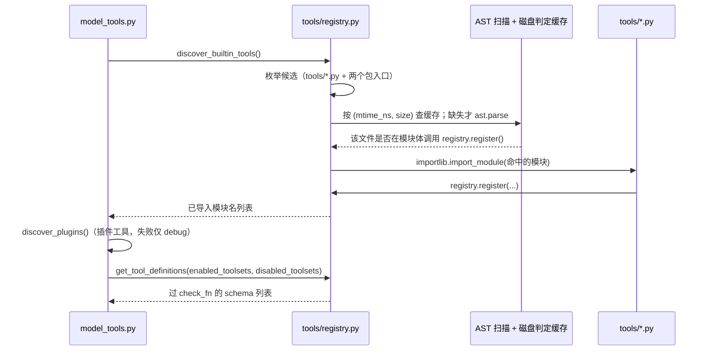

# 06 工具系统与工具集

> 层：第四层（补齐源码逻辑与技术点）
> 状态：已按 2ddb50e41a 复核
> 复核日期：2026-11-16
> 生成日期：2026-11-16
> 前置阅读：[04-核心模块与类型关系](./04-核心模块与类型关系.md)
> 后续阅读：[07-配置体系与环境变量](./07-配置体系与环境变量.md)

## 一、本模块目标

补齐工具系统全貌：

- 工具注册表（`tools/registry.py` · `ToolRegistry`）；
- 工具发现（AST 扫描 + 磁盘缓存，含「哪些文件才被扫描」的判定规则）；
- 工具 schema（动态改写与净化）；
- 工具调用分发（`model_tools.py` · `handle_function_call`）；
- 工具集与核心工具（`toolsets.py` · `TOOLSETS` / `_HERMES_CORE_TOOLS`）；
- 权限/审批（`tools/approval*.py` 族：门控、检测、智能审批、网关等待）；
- 环境隔离（`tools/environments/` · `BaseEnvironment`，7 种后端）；
- 错误体截断与清洗（`_MAX_TOOL_ERROR_CHARS` / `_sanitize_tool_error`）；
- 工具搜索渐进披露（`tools/tool_search.py` 桥三件套）；
- 连接器批处理（`tools/connectors/dispatch.py`）；
- 托管策略（`tools/hosted_tool_policy.py` 白名单）。

## 二、工具系统架构

```mermaid
flowchart TD
    subgraph tools["tools/ (413 py)"]
        R[registry.py · ToolRegistry]
        A[approval*.py (58 文件)]
        E[environments/ (25 py)]
        C[connectors/ (19 py)]
        TS[tool_search.py]
    end

    subgraph model["model_tools.py"]
        G[get_tool_definitions +227]
        H[handle_function_call +908]
        B[_dispatch_bridge_tool +729]
        D[_apply_dynamic_schemas +501]
    end

    subgraph sets["toolsets.py"]
        T[TOOLSETS]
        CORE[_HERMES_CORE_TOOLS]
    end

    R -->|"get_definitions()"| G
    G --> D
    D -->|"sanitize_tool_schemas"| S[schema_sanitizer.py]
    S --> TS
    TS --> M[发给模型的 tool 数组]
    M --> X[agent/tool_executor.py]
    X --> H
    H -->|"registry.dispatch()"| R
    H -->|"approval 门控"| A
    H -->|"env 后端"| E
    H -->|"connector 批"| C
    T --> G
    CORE --> T

    style R fill:#e1f5ff
    style H fill:#e1f5ff
    style T fill:#fff4e1
    style A fill:#ffe1e1
    style E fill:#e1ffe1
```

关键点：**注册表是唯一事实来源**，`model_tools.py` 只做编排（发现、过滤、动态 schema、桥接、钩子/中间件）。

## 三、注册表

### 3.1 位置

- 文件：[`tools/registry.py`](tools/registry.py)（零内部依赖的叶子模块，被每个工具文件 import）

### 3.2 关键符号

| 记法 | 说明 |
|---|---|
| `tools/registry.py` · `Const:_MAX_TOOL_ERROR_CHARS` | `= 2048`，模型可见错误体上限 |
| `tools/registry.py` · `Const:_MAX_LOGGED_ERROR_CHARS` | `= 8192`，日志侧更长但仍有界 |
| `tools/registry.py` · `discover_builtin_tools +121` | 导入自注册工具模块并返回模块名列表 |
| `tools/registry.py` · `class ToolRegistry +596` | 注册表本体（单例） |
| `tools/registry.py` · `ToolRegistry.register +849` | 工具注册入口（新增 `execution_timeout` / `compat_args` / `self_checked_args` / `deadline_floor`） |
| `tools/registry.py` · `ToolRegistry.deregister +932` | 反注册（受与 `override=True` 同一套 operator opt-in 门控） |
| `tools/registry.py` · `ToolRegistry.restore_registration +1000` | 身份校验式回滚（插件卸载用） |
| `tools/registry.py` · `ToolRegistry.register_plugin_override_policy +724` | 绑定「插件命名空间 → operator 是否放行覆盖」 |
| `tools/registry.py` · `ToolRegistry.get_definitions +1040` | 按工具名集合产出 OpenAI 格式 schema，逐个过 `check_fn` |
| `tools/registry.py` · `ToolRegistry.dispatch +1090` | 按名执行 handler，异步经 `_run_async()` 桥接，异常统一成 `{"error": ...}` |
| `tools/registry.py` · `class ToolEntry +216` | 单个工具的元数据（`dataclass(eq=False, slots=True)`，身份语义按 `is` 比较） |
| `tools/registry.py` · `tool_error +1243` / `tool_result +1249` | 取代遍布各处的 `json.dumps({"error": ...})` 样板 |
| `tools/registry.py` · `_check_fn_cached +481` | TTL 缓存（30s）+ 失败宽限（60s 内沿用上次成功） |
| `tools/registry.py` · `_call_check_fn +389` | 在 daemon 线程跑 `bool(fn())`，10s 超时，共享 inflight probe |
| `tools/registry.py` · `_run_check_fn_uncached +448` | 无缓存/宽限处理，捕获 `CheckFnTimeout` / `UnscopedSecretError` |
| `tools/registry.py` · `no_cache_check_fn +292` | 标记本地配置驱动的探针为不缓存 |
| `tools/registry.py` · `invalidate_check_fn_cache +572` | 配置变更后整体清空缓存 |
| `tools/registry.py` · `get_cached_check_fn_result +583` | 只读缓存、绝不触发探针（给 dashboard 面板用） |
| `tools/registry.py` · `check_fn_cache_scope +340` | 返回 active profile key；多 profile 进程按 profile 隔离 |
| `tools/registry.py` · `check_fn_verdict_window +304` | 产出 TTL 窗口，供调用方判断缓存结果是否可复用 |

### 3.3 `register()` 参数（当前签名）

```python
ToolRegistry.register(
    self, name: str, toolset: str, schema: dict, handler: Callable,
    check_fn: Callable | None = None, requires_env: list | None = None, is_async: bool = False,
    description: str = "", emoji: str = "", max_result_size_chars: float | None = None,
    dynamic_schema_overrides: Callable | None = None, override: bool = False,
    scope: Optional[str] = None, execution_timeout: float | None = None,
    compat_args: Iterable[str] = (), self_checked_args: Iterable[str] = (),
    deadline_floor: Callable | None = None):
```

- `scope`：profile 覆盖槽。`None` 走进程级全局表 `_tools`；非 `None` 进该 profile 的 `_scoped_tools` 覆盖层。插件注册时若 `scope` 为 `None` 且能识别出插件归属，会自动落到该插件所在 profile 的槽（`ToolRegistry.register +849` 内部）。
- `dynamic_schema_overrides`：零参可调用，每次 `get_definitions()` 把返回的 dict 浅合并进 schema（例如 `delegate_task` 的描述要反映当前并发上限）。
- `execution_timeout`：handler 执行超时（秒），用于 connector 批处理的 per-call 预算。
- `compat_args` / `self_checked_args`：参数兼容性声明，供 `tools/arg_validation.py` 做更精细的拒绝。
- `deadline_floor`：可调用，返回该工具调用可 legitimately block 的最短时间（秒），用于 connector 批处理的 deadline 计算。
- **schema 在注册时就被校验**：`schema` 必须是 dict，`schema["parameters"]` 若存在必须是对象，否则直接抛 `ValueError`。这是刻意的——非法 schema 会序列化进每一次 provider 请求并在离现场很远的地方 400。

### 3.4 注册冲突规则

- **同 toolset 内同名重复注册**：允许，静默覆盖（MCP 重连/刷新依赖这条）。
- **跨 toolset shadow**：默认**拒绝**，只记 `logger.error` 并 return，不抛异常；确需替换必须显式传 `override=True`。
- **插件 shadow 进程级全局工具**：没有 `override=True` 直接拒绝并记 error。
- **插件 `override=True`**：还额外受 operator 配置门控 `plugins.entries.<plugin_id>.allow_tool_override: true`；未放行时抛 `PermissionError`。
- 插件的「归属」绑定在 handler 的**定义模块**上（`handler.__globals__["__name__"]`，`ToolRegistry._plugin_owner_of +765`），随包装器/`partial`/`__wrapped__` 解析，因此插件无法用回调洗白一次覆盖。
- 反注册同样门控：插件不能反注册不属于自己的工具（否则可先删后占空位绕过覆盖检查）；`mcp-*` toolset 例外。

### 3.5 规模与文件分族

- `tools/` 实测 **413 个 `.py`**（顶层 330 个，包式子目录 3 个：`tools/connectors/` 19 py、`tools/environments/` 25 py、`tools/computer_use/` 13 py），另有数据目录（`tools/wakewords/`、`tools/neutts_samples/`）。
- 分族规律是**「一个主题拆成一族 `<stem>_<topic>.py` 兄弟文件」**，不是子目录。实测较大的族（按顶层文件前缀统计）：

| 族 | 顶层文件数 | 代表文件 |
|---|---|---|
| `mcp_*` | 28 | `tools/mcp_tool.py`、`tools/mcp_tool_transport.py`、`tools/mcp_oauth_manager.py` |
| `approval*` | 28 | `tools/approval.py`、`tools/approval_detection.py`、`tools/approval_smart.py`、`tools/approval_prompt.py`、`tools/approval_wrappers.py` |
| `browser*` | 25 | `tools/browser_tool.py`、`tools/browser_session.py`、`tools/browser_launcher.py` |
| `skills_*` / `skill_*` | 19 | `tools/skills_hub.py`、`tools/skills_sync.py`、`tools/skill_manager_tool.py` |
| `delegate_*` | 16 | `tools/delegate_tool.py`、`tools/delegate_tool_dispatch.py` |
| `process_registry*` | 16 | `tools/process_registry.py`、`tools/process_registry_checkpoint.py` |
| `terminal_*` | 12 | `tools/terminal_tool.py`、`tools/terminal_tool_backends.py`、`tools/terminal_tool_lifecycle.py` |
| `tts_*` | 12 | `tools/tts_tool.py`、`tools/tts_tool_providers.py`、`tools/tts_streaming.py` |
| `file_*` | 10 | `tools/file_tools.py`、`tools/file_operations.py`、`tools/file_state.py` |

  注意：**只有族里的「facade」才含 `registry.register()`**，其余兄弟文件是纯库文件（见 §4.2）。
- 只有 2 个包式工具（在包内入口注册）：`tools/connectors/tool.py`、`tools/computer_use/tool.py`。

## 三点五、真实代码映射

| 主题 | 真实文件 | 真实符号/说明 |
|---|---|---|
| 工具注册表 | `tools/registry.py` | `ToolRegistry.register +849` |
| 工具发现 | `tools/registry.py` | `discover_builtin_tools +121` |
| 工具定义 | `model_tools.py` | `get_tool_definitions +227` / `_compute_tool_definitions +524` |
| 工具分发 | `model_tools.py` | `handle_function_call +908` |
| 参数类型修复 | `tools/arg_coercion.py` | `coerce_tool_args`（已从 `model_tools.py` 迁出） |
| 参数校验 | `tools/arg_validation.py` | `check_tool_args` / `flag_unknown_args` |
| 工具集定义 | `toolsets.py` | `TOOLSETS` / `_HERMES_CORE_TOOLS` |
| 工具集抽样 | `toolset_distributions.py` | `sample_toolsets_from_distribution` |
| 工具执行入口 | `agent/tool_executor.py` | `execute_tool_calls_segmented` |
| 单工具调用 | `agent/agent_runtime_helpers.py` | `invoke_tool`（`AIAgent._invoke_tool` 懒转发） |
| 工具批段规划 | `agent/tool_dispatch_helpers.py` | `_plan_tool_batch_segments` |
| Agent 级内联工具 | `agent/inline_tool_executors.py` | `INLINE_TOOL_EXECUTORS`（`todo_list`/`memory`/`session_search`/`delegate_task` 不走 `handle_function_call` 的 handler 路径） |
| 工具护栏 | `agent/tool_guardrails.py` | 工具安全/护栏 |
| 工具结果分类 | `agent/tool_result_classification.py` | 工具结果分类 |
| 工具搜索桥 | `tools/tool_search.py` | `is_bridge_tool +385`、`resolve_underlying_call +582`、`assemble_tool_defs +347` |
| 桥接工具名常量 | `tools/tool_search_catalog.py` | `BRIDGE_TOOL_NAMES` |
| schema 净化 | `tools/schema_sanitizer.py` | `sanitize_tool_schemas +133` |
| 环境隔离 | `tools/environments/base.py` | `BaseEnvironment +285` |
| 环境选择器 | `tools/terminal_tool_backends.py` | `_create_environment +295` / `_BUILTIN_BACKENDS +52` |
| 环境生命周期 | `tools/terminal_tool_lifecycle.py` | `get_active_env +220` |
| 审批门控 | `tools/approval.py` | `check_all_command_guards +1421` / `is_approved +485` |
| 审批检测 | `tools/approval_detection.py` | `HARDLINE_PATTERNS +184` |
| 智能审批 | `tools/approval_smart.py` | `_smart_verdict +229` |
| 审批提示 | `tools/approval_prompt.py` | `prompt_dangerous_approval +20` |
| 连接器分发 | `tools/connectors/dispatch.py` | `dispatch_connector_call +11` / `dispatch_connector_batch +24` |
| 托管策略 | `tools/hosted_tool_policy.py` | `hosted_tool_refusal +83` / `HOSTED_TOOL_ALLOWLIST +38` |

## 四、工具发现

### 4.1 位置

- `tools/registry.py` · `discover_builtin_tools +121`
- `tools/registry.py` · `_tool_module_candidates +112`
- `tools/registry.py` · `_module_registers_tools +94`
- `model_tools.py` · `get_tool_definitions +227`

### 4.2 流程



判定规则（都来自源码，不是约定）：

1. **候选集**：扁平 `tools/*.py` 加上各包的一层入口模块（每个包只取那一个入口文件 `tools/<pkg>/tool.py`），合并后统一排序（`_tool_module_candidates +112`）。包内**只扫入口文件**，所以同包其余文件天然是库文件。
2. **硬跳过**：包初始化文件、`tools/registry.py`、`tools/mcp_tool.py` 不参与（后者由 MCP 发现流程单独导入）。
3. **必须真的注册**：只有**模块体**（含模块级 `for` 循环）里出现 `registry.register(...)` 的文件才会被 import（`_module_registers_tools +94`）。表驱动模块在一个 `for` 里批量注册，同样算命中。
4. **包必须有包初始化文件**：缺了会 `logger.warning` 跳过——否则 checkout 里能注册、装进 wheel 后消失。
5. **判定结果有磁盘缓存**：落在 `get_hermes_home()` 的 `cache/` 子目录下（`tools/registry.py` · `_discovery_cache_path +178`），键是绝对路径，值是 `[mtime_ns, size, registers]`；缓存不一致或损坏只重扫该文件。源码注释给出的量级是「逐文件 AST 扫描约 145 ms / 约 100 个文件」，所以缓存是启动时间的关键。
6. **插件工具**：`model_tools.py` 在 import 期调用 `hermes_cli/plugins.py` · `discover_plugins +0`，插件经 `ctx.register_tool()` 注册（见 [09-技能系统与插件架构](./09-技能系统与插件架构.md)）。
7. **MCP 发现刻意不在这里**：`discover_mcp_tools()` 内部会阻塞等待最长 120 s，而 gateway 是在事件循环里懒加载 `model_tools` 的，因此它被移出模块级副作用，由各入口（`gateway/run.py`、`cli.py`、`tui_gateway`、`acp_adapter`）在启动时各自触发。
8. **Safe Worker 策略**：`safe_worker_enabled()` 为真时（故障排查 worker），只导入三个核心模块（`tools.file_tools`、`tools.terminal_tool`、`tools.process_registry`），跳过插件/发现缓存（`discover_builtin_tools +121` 内部）。

## 五、工具调用分发

### 5.1 位置

- `model_tools.py` · `handle_function_call +908`

### 5.2 主流程

1. `tools/arg_coercion.py` · `coerce_tool_args` 做 schema 引导的类型修复（`"42"` → `42`、`"true"` → `True`、JSON 编码的字符串 → 原生数组/对象；无法确定时保留原值）；
2. 旧工具名别名归一（`model_tools.py` · `_LEGACY_TOOL_ALIASES +638`：`todo`→`todo_list`、`cronjob`→`cronjob_manage`、`process`→`process_manage`、`tour`→`gui_tour`、`tip`→`show_tip`；schema 只广告新名）；
3. **`tool_search` 桥接**：`_dispatch_bridge_tool +729` 处理 `tool_search`/`tool_describe`（就地读目录）与 `tool_call`（解包后**递归回本函数**，让下游所有钩子看到真实工具名）。桥接目录按本次会话的 `enabled_toolsets`/`disabled_toolsets` 重新取一遍未折叠 schema，且要再校验 `scoped_deferrable_names` 与目标工具的具体 schema；
4. `tool_request` 中间件（`_apply_request_middleware +781`，fail-open）；
5. 预派发守卫 `_pre_dispatch_guards +794`：插件 `pre_tool_call` 钩子（可阻断/可改参）→ ACP/Zed 编辑审批（`acp_adapter/edit_approval.py` · `maybe_require_edit_approval`）；
6. **连接器特殊路径**：`manage_connections` 或 `connectors__<connector>__<tool>` 走 `tools/connectors/dispatch.py` · `dispatch_connector_call +11`；批处理走 `dispatch_connector_batch +24`（每 call 独立 policy/middleware/hooks/call id）；
7. `registry.dispatch(...)` 执行 handler；connector 工具改走 `tools/connectors/dispatch.py`；
8. `tool_execution` 中间件包裹（`_execute_tool +851`）；
9. `post_tool_call` 观察钩子（`_emit_post_tool_call_hook +702`）；
10. `transform_tool_result` 钩子可整体替换结果字符串（`_apply_transform_tool_result_hook`，fail-open，首个字符串返回值胜出）；
11. 返回 JSON 字符串。

`_AGENT_LOOP_TOOLS`（`todo_list`、`memory`、`session_search`、`delegate_task`）被 agent loop 拦截，走到这里只会得到一句 stub 错误。

### 5.3 错误体截断与清洗

- 工具错误返回模型前截断到 **2048** 字符（`_MAX_TOOL_ERROR_CHARS`），截断标记 `… [truncated]`；
- 日志保留更长信息（`_MAX_LOGGED_ERROR_CHARS = 8192`）；
- 关键补强：handler 里直接 `json.dumps({"error": str(exc)})` 会绕过 `tool_error` 的上限，因此派发边界上还有一层 `_bound_json_error_result +67`，把 JSON 结果里超长的 `error` 字段单独裁掉——防止失败重试时错误体层层堆叠；
- `model_tools.py` · `_sanitize_tool_error +657` 另做结构性清洗：剥掉 `</tool_call>` / `</function_call>` / `<![CDATA[...]]>` / 代码围栏，加 `[TOOL_ERROR]` 前缀，并复用**同一个** 2048 上限（保证文本不会经过两个不同上限、带两种不同标记）；
- `_TOOL_ERROR_STRIP_RES +649`：四条正则，分别 stripping XML-like tags、code fences、CDATA；
- 目的：防止工具错误污染 prompt 与 token 成本。

### 5.4 托管策略（Hosted Tool Policy）

- `tools/hosted_tool_policy.py` · `hosted_tool_refusal +83`：在托管作用域（`hosted_scope() is not None`）内，只允许白名单工具运行；
- `HOSTED_TOOL_ALLOWLIST +38`：`terminal`、`process_manage`、`execute_code`、`read_file`、`write_file`、`patch`、`search_files`；
- 非白名单工具返回错误：「{tool} is not available to a hosted agent: {why}. A hosted agent's tools are {allowlist}, all run in its own sandbox.」；
- `HOST_FEATURES +43`：17 项宿主特征（`context_files`、`subdirectory_hints`、`context_references`、`workspace_snapshot`、`backend_probe`、`builtin_memory`、`session_recall`、`background_review`、`trajectory_export`、`file_mutation_bookkeeping`、`checkpoints`、`media_processing`、`skills`、`skill_inline_shell`、`cron_scripts`、`shell_hooks`、`tool_host_artifacts`、`mcp_stdio`、`media_delivery`、`transcription`、`delegation`），托管作用域内全部禁用；
- `host_feature_enabled +91` / `host_feature_refusal +99` / `require_host_feature +106`：特征门控三件套。

## 六、工具集

### 6.1 位置

- 文件：[`toolsets.py`](toolsets.py)（`TOOLSETS` 单一大字典）
- 相关：`toolset_distributions.py`（批量数据生成的工具集抽样）

### 6.2 核心工具集

- `_HERMES_CORE_TOOLS`（`toolsets.py` · `_HERMES_CORE_TOOLS +11`）：每次 API 调用都发送的核心集；平台基础 toolset 默认继承它，**不是死代码**。
- 实测该列表含 **41 个工具**：`web_search`、`web_extract`、`terminal`、`process_manage`、`read_file`、`write_file`、`patch`、`search_files`、`vision_analyze`、`image_generate`、`skills_list`、`skill_view`、`skill_manage`、`browser_exec`、`browser_cdp`、`browser_dialog`、`browser_vault`、`text_to_speech`、`todo_list`、`memory`、`session_search`、`clarify`、`execute_code`、`delegate_task`、`cronjob_manage`、`kanban_*` 一族（`kanban_show`、`kanban_list`、`kanban_complete`、`kanban_block`、`kanban_request_review`、`kanban_request_changes`、`kanban_heartbeat`、`kanban_comment`、`kanban_create`、`kanban_link`、`kanban_unblock`、`kanban_attach`、`kanban_attach_url`、`kanban_attachments`）、`computer_use`、`manage_connections`。
- 工具被 `discover_builtin_tools()` 注册**不等于**会被暴露：必须有一个 toolset 点名它（`toolsets.py` · `resolve_toolset +355`）。
- 平台 bundle（`hermes-<platform>`）与 `posture` 类 toolset 会重新列出核心工具但**并不拥有它们**，所以从 `disabled_toolsets` 里减掉时只减非核心增量（`toolsets.py` · `bundle_non_core_tools +310`，`model_tools.py` · `_apply_toolset_selection +302`）。
- 插件注册的 toolset 会与静态 `TOOLSETS` 合并（`toolsets.py` · `get_all_toolsets +422`），别名由 `registry.register_toolset_alias()` 维护。

### 6.3 门控方式

- **`check_fn`（可用性门控，profile 维度缓存）**：
  - 语义**仍然成立且被加强**：`tools/registry.py` · `_check_fn_cached +481` 仍是「TTL 缓存 + 单次装配内去重」；
  - TTL 为 **30 秒**（`_CHECK_FN_TTL_SECONDS = 30.0`），理由是 `hermes tools enable` 之后一两轮内就该生效；
  - **新增失败宽限**：60 秒内刚成功过的探针失败，视为抖动，继续沿用上一次的 True 且**不写缓存**（`_CHECK_FN_FAILURE_GRACE_SECONDS = 60.0`）。超过宽限仍失败才真正采纳 False；
  - **缓存键是 `(check_fn, scope)`**，`scope` 由 `check_fn_cache_scope +340` 决定：多 profile 进程按 profile 隔离；浏览器控制类请求会返回 `CHECK_FN_CACHE_BYPASS` 哨兵，连 `model_tools.py` 的外层定义缓存一起绕过（一个 Browser 会话的实时工具不能漏进另一个）；
  - `no_cache_check_fn +292` 可把「本地配置驱动」的探针标为不缓存；`invalidate_check_fn_cache +572` 在配置变更后整体清空；`get_cached_check_fn_result +583` 只读缓存、**绝不**触发探针（给 dashboard 面板用）；
  - toolset 级可用性现在由**逐工具**推导：`ToolRegistry._toolset_has_exposable_tools +662`，`_toolset_checks` 只用于 `get_toolset_requirements()` 给 banner 做「懒加载 vs 已禁用」分类，**不再门控整个 toolset**；
  - 核心工具被探针掉线时会打一次 WARNING（`_check_fn_core_drop_warned`），因为核心工具不可延迟披露，掉了就是 schema 和目录里都查不到。
- **toolset**：session 级能力门控。
- **插件**：第三方/用户特定能力。
- **MCP server**：外部工具目录。
- **工具搜索（渐进披露）**：`tools/tool_search.py` · `assemble_tool_defs +347` 在最后一步把 MCP/插件工具折叠成 `tool_search`/`tool_describe`/`tool_call` 三件套；桥接工具名集合在 `tools/tool_search_catalog.py` · `BRIDGE_TOOL_NAMES +21`。核心工具**永不**被延迟披露。

### 6.4 工具集分发（`toolset_distributions.py`）

这是**批量数据生成**用的独立机制，与运行时门控无关：

- `DISTRIBUTIONS`（`toolset_distributions.py` · `DISTRIBUTIONS +18`）把「分布名 → {toolset: 启用概率%}」；
- `sample_toolsets_from_distribution +67` 逐项独立掷骰；键可以写成 `"browser+search"` 这种 `+` 复合组，一次掷骰决定全组（避免两次 97% 独立掷骰只剩 ~94% 共现）；
- 全部落空时回退到概率最高的那一项；未知分布抛 `ValueError`；
- 它只依赖 `toolsets.py` · `validate_toolset +486` 做校验，不读写注册表，也不影响 CLI/网关的 toolset 选择。

### 6.5 动态 Schema 改写器

- `_DYNAMIC_SCHEMA_REWRITERS +489`：按工具名注册的改写器列表，在 `get_definitions()` 里逐工具应用；
- 已知改写器：`execute_code`（可用沙箱工具集改写）、`discord` / `discord_admin`（动态 schema）、`browser_cdp`、`browser_exec`（组合改写：exec/vision/vault）、`browser_vault`、`drive_preview`、`delegate_task`（并发上限）；
- `_apply_dynamic_schemas +501`：按列表顺序应用改写器，availability set 是改写前快照（确保改写器之间不互相影响）。

## 七、环境隔离

### 7.1 位置

- 目录：[`tools/environments/`](tools/environments/)（25 py，一个 `BaseEnvironment` ABC，`tools/environments/base.py` · `class BaseEnvironment +285`）
- 选择器：`tools/terminal_tool_backends.py` · `_create_environment +295`，读 `TERMINAL_ENV`

### 7.2 支持环境

内置 6 种（`tools/terminal_tool_backends.py` · `_BUILTIN_BACKENDS +52`）：

- `local`
- `docker`
- `modal`（直连或 Nous 托管网关两态）
- `daytona`
- `vercel_sandbox`
- `ssh`

外加**插件注册的 backend**：`_ENV_BUILDERS +277` 查不到时回落到插件 provider（`tools/terminal_tool_backends.py` · `_build_plugin_env +259` → `agent/terminal_env_registry.py` · `plugin_backend_names +0`）。新增 backend 的做法是往现有表里加一行，而不是写 `elif` 分支。

（注：上一版文档列的 `singularity` 已不存在。）

### 7.3 关键概念

- `task_id` 用于隔离终端/浏览器会话；
- 每个任务可有独立 cwd、环境变量、进程；docker 后端还有「会话作用域容器」（跨轮存活、会话结束/空闲超时即回收）与孤儿容器回收器；
- 取活动环境用 `tools/terminal_tool_lifecycle.py` · `get_active_env +220`；
- 后台进程收尾由 `tools/process_registry.py` 统一负责（先 SIGTERM 父进程、等它自己收掉子树，再处理幸存者）；
- `BaseEnvironment` ABC 提供：`get_temp_dir +335`、`cleanup +372`、`fetch_file +379`、`fetch_realpath +409`、`_run_bash +365` 等抽象方法；
- `FileFetchError +154` / `EnvironmentConnectionError +162`：两类环境异常；
- `set_activity_callback +179` / `get_activity_callback +184` / `touch_activity_if_due +194`：活动心跳机制；
- `get_sandbox_dir +209`：沙箱目录（`HERMES_HOME/sandboxes` 或 `TERMINAL_SANDBOX_DIR` 覆盖）。

## 八、审批与权限控制

### 8.1 位置

- 主模块：[`tools/approval.py`](tools/approval.py)（审批状态机、永久允许列表、网关通知）
- 检测模块：[`tools/approval_detection.py`](tools/approval_detection.py)（硬线模式、敏感路径正则）
- 智能审批：[`tools/approval_smart.py`](tools/approval_smart.py)（LLM 辅助 verdict）
- 审批提示：[`tools/approval_prompt.py`](tools/approval_prompt.py)（人类提示、传输选择）
- 包装器：[`tools/approval_wrappers.py`](tools/approval_wrappers.py)（命令剥离、变体生成）
- 审批族规模：**58 个 `.py`**（`approval*.py` / `*approval*.py`）

### 8.2 核心符号

| 记法 | 说明 |
|---|---|
| `tools/approval.py` · `check_all_command_guards +1421` |  consolidated command guard（terminal tool 调用） |
| `tools/approval.py` · `is_approved +485` | 检查 session + pattern_key 是否已批准 |
| `tools/approval.py` · `_user_approved +687` | 用户批准返回结构 |
| `tools/approval.py` · `approve_permanent +500` / `save_permanent_allowlist +583` | 永久允许列表 |
| `tools/approval.py` · `resolve_gateway_approval +150` / `resolve_gateway_approval_card +207` | 网关审批解析 |
| `tools/approval.py` · `withdraw_gateway_approval +238` | 撤回已批准的请求 |
| `tools/approval.py` · `has_blocking_approval +298` / `pending_gateway_approval_count +304` | 阻塞审批查询 |
| `tools/approval.py` · `enable_session_yolo +354` / `disable_session_yolo +359` | YOLO 模式开关 |
| `tools/approval_detection.py` · `HARDLINE_PATTERNS +184` | 硬线模式正则列表（redirect to raw block device、fork bomb、system config write 等） |
| `tools/approval_smart.py` · `_smart_verdict +229` | LLM 辅助 verdict（APPROVE/DENY） |
| `tools/approval_prompt.py` · `prompt_dangerous_approval +20` | 危险命令提示 |
| `tools/approval_wrappers.py` · `strip_wrapper_prefixes +224` / `carried_command_variants +294` | 命令剥离与变体 |

### 8.3 审批流程（Terminal Tool 为例）

```mermaid
sequenceDiagram
    participant T as terminal_tool.py
    participant A as approval.py
    participant D as approval_detection.py
    participant S as approval_smart.py
    participant P as approval_prompt.py

    T->>A: check_all_command_guards(command, env_type, has_host_access)
    A->>D: 硬线检测（HARDLINE_PATTERNS）
    D-->>A: 命中→直接 DENY
    A->>S: 智能审批（_smart_verdict）
    S-->>A: verdict + reasoning
    A->>A: is_approved(session_key, pattern_key)?
    A-->>T: True → 执行
    A->>P: 未批准→prompt_dangerous_approval
    P->>用户：选择 Approve/Deny/Permanent
    P-->>A: 记录选择
    A-->>T: 返回批准/拒绝结果
```

### 8.4 硬线模式（Hardline）

- `HARDLINE_PATTERNS +184`：20+ 条正则，覆盖高危命令（redirect to raw block device、fork bomb、system config write、SSH sensitive path、Hermes home/env/config path、credential files、secret var upload 等）；
- `_SENSITIVE_WRITE_TARGET +90` / `_USER_SENSITIVE_WRITE_TARGET +94` / `_HOME_SENSITIVE_WRITE_TARGET +97` / `_PROJECT_SENSITIVE_WRITE_TARGET +106`：四类敏感写目标；
- `_QUOTED_ROOT_SYSTEM_DIR +170`：quoted system dir detection；
- `_RM_FLAG_PREFIX +176` / `_PS_INCLUDE_NARROWS +180`：rm / ps 命令特殊处理；
- 命中硬线模式直接 DENY，不进入人类审批。

### 8.5 智能审批（Smart Approval）

- `tools/approval_smart.py` · `_smart_verdict +229`：调用 LLM 对命令 + 描述做 verdict（APPROVE/DENY）+ reasoning；
- `_SYSTEM_PROMPT +18`：系统提示，定义审批策略；
- `_VERDICTS +34`：`{"APPROVE": "approve", "DENY": "deny"}`；
- `_get_smart_policy +148`：读取配置 `approvals.smart.policy`；
- `_verdict_reasoning +154`：提取 reasoning 段落；
- `_smart_approve +168`：智能批准逻辑（strip comments、heredoc 检测、shell 解析）。

### 8.6 审批提示与传输

- `tools/approval_prompt.py` · `prompt_dangerous_approval +20`：生成人类提示（command/description/timeout/allow_permanent）；
- `_ask_human +110`：人类输入读取（timeout 支持）；
- `_present_with_selected_transport +199`：多传输方式选择（CLI prompt / gateway card / plugin transport）；
- `_transport_choice +256`：传输选择逻辑；
- `_remembered_consent +287`：记住的选择处理；
- `get_plugin_manager +185`：插件管理器（传输插件）。

### 8.7 包装器与变体

- `tools/approval_wrappers.py` · `strip_wrapper_prefixes +224`：剥离 `sudo` / `su` / `ssh` / `docker` / `timeout` 等包装前缀；
- `carried_command_variants +294` / `hardline_detection_variants +320`：生成变体（用于检测绕过）；
- `_su_command_payload +242` / `_carried_payloads +268`：提取被携带的命令载荷；
- `_blank_literal_heredoc_bodies +347` / `literal_heredoc_bodies +401`：heredoc 体检测与空白化；
- `dequote_rm_operands +360`：rm 操作数去引用。

### 8.8 网关审批（Gateway Approval）

- `tools/approval.py` · `resolve_gateway_approval +150` / `resolve_gateway_approval_card +207`：网关审批解析（支持 card UI）；
- `register_gateway_notify +128` / `unregister_gateway_notify +135`：网关通知回调注册；
- `withdraw_gateway_approval +238`：撤回已批准的请求（cause 参数）；
- `list_gateway_approvals +255` / `list_gateway_approval_authority +261`：审批列表查询；
- `register_gateway_settle +267` / `observe_gateway_settle +278`：审批结算观察；
- `ack_gateway_approval +288`：确认审批；
- `restrict_gateway_approval_card_to_deny +198`：限制 card 只能 DENY；
- `_DENIAL_TALLY_MAX_SESSIONS +71` / `_get_denial_breaker_threshold +74` / `_record_denial +82`：拒绝计数与熔断。

### 8.9 YOLO 模式

- `tools/approval.py` · `enable_session_yolo +354` / `disable_session_yolo +359`：会话级 YOLO 开关；
- `is_session_yolo_enabled +395` / `is_current_session_yolo_enabled +403`：YOLO 状态查询；
- `_yolo_active +408` / `_permanent_set +417`：YOLO / permanent 状态内部查询；
- `_set_session_yolo +346`：设置会话 YOLO 状态；
- `_sync_permanent_from_disk +434`：从磁盘同步 permanent 列表；
- `_session_grant_key +452` / `_approval_scope +466`：审批 scope 计算。

## 九、工具搜索渐进披露

### 9.1 位置

- 主模块：[`tools/tool_search.py`](tools/tool_search.py)
- 常量：[`tools/tool_search_catalog.py`](tools/tool_search_catalog.py) · `BRIDGE_TOOL_NAMES`
- 配置：`hermes_cli/config_defaults.py` · `tools.tool_search`

### 9.2 桥接工具

- `BRIDGE_TOOL_NAMES +21`：`frozenset({"tool_search", "tool_describe", "tool_call"})`；
- `TOOL_SEARCH_NAME +18` / `TOOL_DESCRIBE_NAME +19` / `TOOL_CALL_NAME +20`：三桥接工具名；
- `is_bridge_tool +385`：判断是否为桥接工具；
- `dispatch_tool_search +442` / `dispatch_tool_describe +499`：桥接工具处理器；
- `resolve_underlying_call +582`：解析 `tool_call` 的真实工具名 + 参数；
- `validate_deferred_call_args`：校验 deferred 工具的参数（在 `tool_search_validation.py`）；
- `scoped_deferrable_names +548` / `out_of_scope_reason +557` / `scope_block_reason +572`：session scope 门控。

### 9.3 激活条件

- `should_activate +207`：`enabled != "off"` 且 `deferrable_tokens > 0` 或 `connections_granted` 时激活；
- `ToolSearchConfig +43`：配置对象（`enabled` / `threshold_pct` / `search_default_limit` / `max_search_limit` / `listing` / `listing_max_tokens` / `effective_defer_tools`）；
- `load_config +113`：从 `tools.tool_search` 配置加载；
- `DEFAULT_CONFIG["tools"]["tool_search"]`：默认配置（`enabled: "auto"` / `threshold_pct: 5` / `listing: "auto"` / `listing_max_tokens: 4000` / `defer: [...]`）；
- `_DEFAULT_DEFERRED_TOOLS +150`：默认延迟工具列表（`computer_use`、`session_search`、`image_generate`、`todo_list`、`process_manage`、`cronjob_manage`、`browser_vault`、`text_to_speech`、`manage_connections`、Desktop GUI 工具等）；
- `_core_tool_names +129`：永不延迟的核心工具名（`TOOLSETS` 中 `platforms` 字段定义的平台工具集）。

### 9.4 装配流程

- `assemble_tool_defs +347`：工具定义装配（passthrough / tier 1 / tier 2）；
- `AssemblyResult +335`：装配结果（`tool_defs` / `activated` / `deferred_count` / `deferred_tokens` / `threshold_tokens` / `tier` / `listing_form`）；
- `classify_tools +180`：工具分类（visible / deferrable）；
- `estimate_tokens_from_schemas +197`：schema token 估算（chars/4）；
- `listing_token_budget +219`：listing token 预算（`min(threshold_pct% of context, listing_max_tokens)`）；
- `build_catalog_listing_with_form`：构建 catalog listing（full / names / mixed / groups / none）；
- `bridge_tool_schemas +274`：生成桥接工具 schema（含 listing 嵌入）；
- `connections_in_scope`：检查 connectors 是否在 scope 内。

### 9.5 Tier 分级

- **Tier 0**：未激活，全部工具直出；
- **Tier 1**：激活，桥接工具 + catalog listing（full/names/mixed）；
- **Tier 2**：激活，仅桥接工具 + server summary（listing 超限或 names-only 也超限）；
- `tier` 字段：0/1/2；
- `listing_form`：`"full"` / `"names"` / `"mixed"` / `"groups"` / `"none"`。

### 9.6 配置默认值（`hermes_cli/config_defaults.py`）

```yaml
tools:
  tool_search:
    enabled: "auto"          # "auto"|"on"|"off"
    threshold_pct: 5         # 5% of context length
    search_default_limit: 5  # hits per query
    max_search_limit: 25     # hard upper bound
    listing: "auto"          # "auto"|"on"|"off"
    listing_max_tokens: 4000 # absolute cap
    defer:                   # deferred tools list
      - computer_use
      - session_search
      - image_generate
      - todo_list
      - process_manage
      - cronjob_manage
      - browser_vault
      - text_to_speech
      - manage_connections
      - drive_preview
      - gui_tour
      - desktop_preview
      - annotate_preview
      - manage_catalog
      - show_tip
      - desktop_project
      - close_terminal
      - set_theme
      - read_terminal
      - read_window_below
      - focus_pane
```

## 十、连接器（Connectors）

### 10.1 位置

- 目录：[`tools/connectors/`](tools/connectors/)（19 py + 2 子目录 `gateway/` / `portal/`）
- 分发：[`tools/connectors/dispatch.py`](tools/connectors/dispatch.py)

### 10.2 核心符号

| 记法 | 说明 |
|---|---|
| `tools/connectors/dispatch.py` · `dispatch_connector_call +11` | 单 call 分发（remote run + data_use record） |
| `tools/connectors/dispatch.py` · `dispatch_connector_batch +24` | 批处理分发（per-call policy/middleware/hooks/call id） |
| `tools/connectors/__init__.py` · `CONNECTOR_BATCH_SENTINEL` | 批处理哨兵（转发到 `tools.connectors.gateway.names`） |
| `tools/connectors/gateway/config.py` · `MAX_CALLS_PER_DISPATCH` | 每批最大 call 数 |
| `tools/connectors/gateway/merge.py` · `partition_calls` / `assemble_results` / `fill_remote_failure` | 调用分区与结果合并 |
| `tools/connectors/gateway/bridge.py` · `run_remote` | 远程执行 |
| `tools/connectors/data_use.py` · `record_data_use` | 数据使用记录 |
| `tools/interrupt.py` · `is_interrupted +57` | 中断检查（批处理每 call 前检查） |

### 10.3 批处理语义

- `dispatch_connector_batch +24`：
  - 每 call 独立：自己的 policy、middleware、hooks、call id（`<id>#<position>`）；
  - 观察者不会把 entry 折叠到 wrapper 或兄弟 entry；
  - `is_interrupted()` 每 call 前检查，`/stop` 可阻止未开始的远程副作用；
  - `MAX_CALLS_PER_DISPATCH` 超限返回错误；
  - local calls 返回错误（`local_batch_error`）；
  - remote calls 逐 call 执行，结果合并。

### 10.4 连接器工具名格式

- `connectors__<connector>__<tool>`：连接器工具名格式；
- `tools/connectors/gateway/names.py` · `is_connector_name +35`：判断是否为连接器工具名；
- `tools/connectors/gateway/names.py` · `parse_connector_name`：解析连接器工具名。

## 十一、本模块结论

本模块补齐了工具注册、发现、分发、工具集、门控与环境隔离，并补上了两处上一版缺失的机制：**工具搜索渐进披露**与 **`toolset_distributions.py` 抽样分发**。**审批/权限控制**是本版重点扩写主题（58 文件族，覆盖硬线检测、智能审批、人类提示、网关审批、YOLO 模式、包装器变体）。后续模块继续展开配置、数据模型、技能/插件、调度、并发、错误、测试、部署和源码索引。

---

上一篇：[05-消息网关与平台适配](./05-消息网关与平台适配.md) ｜ 总目录：[./README.md](./README.md) ｜ 下一篇：[07-配置体系与环境变量](./07-配置体系与环境变量.md)
