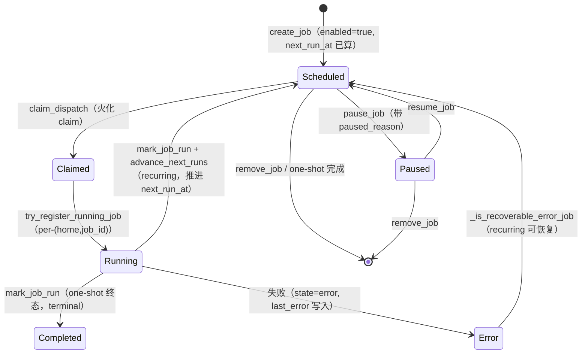
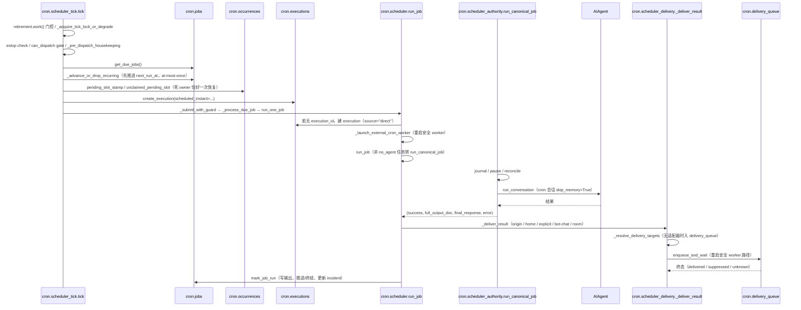

# 10 调度器与定时任务

> 层：第四层（补齐源码逻辑与技术点）
> 状态：已按 2ddb50e41a 复核
> 复核日期：2026-11-16
> 生成日期：2026-08-19
> 前置阅读：[04-核心模块与类型关系](./04-核心模块与类型关系.md)
> 后续阅读：[11-并发模型与生命周期](./11-并发模型与生命周期.md)

> **本版定位记法**：一律「`文件路径` · `符号名` `+N`」，`+0` = 符号定义行，`+N` = 符号体内第 N 行。
> 正文不出现绝对行号。本版基于提交 `2ddb50e41a`（main，2026-11-16）静态分析；**未运行测试套件**，
> 不对"测试是否通过"作声明。

## 一、本模块目标

补齐调度器与定时任务：

- `cron/` 目录（**顶层 57 个 py + `cron/scripts/` 下 2 个 = 59 个 py 文件**）；
- 触发抽象与调度器主循环（含多 profile 复用与外部 provider）；
- 任务定义与任务存储（`jobs.py` 门面 + `jobs_*.py` 一族）；
- 执行记录（executions 账本 + occurrences 槽位）；
- 跨平台投递与重启安全投递队列；
- 失败、重试、事故与诊断；
- **Kanban 多代理工作队列的调度器**（`hermes_cli/kanban.py` + `gateway/kanban_watchers*.py`）。

> 本轮（自上一版基准 `e1fdf003a6` 起）最重要的三件事：
>
> 1. **`cron/bot_chat_delivery.py` 已不存在**。旧文档引用的 `drain` / `drain_in_background`
>    两个符号随之消失。当前对应物是 `cron/bot_chat_legacy.py`（`defer` `+0`、
>    `drain_legacy_pending` `+0`）：它只负责"把**遗留的、格式化的** Bot Chat 待投递记录排干"，
>    不再是活路径。活的 Bot Chat 投递走 `cron/scheduler_delivery.py` · `_deliver_to_bot_chat` `+0`
>    （`BOT_CHAT_PLATFORM = "bot-chat"`）与 `cron/scheduler_delivery_room.py` · `deliver_to_room` `+0`
>    （`ROOM_PLATFORM = "room"`）。
> 2. **外部 provider 落地**：`plugins/cron_providers/chronos/`（NAS 中介的 scale-to-zero
>    cron provider，`class ChronosCronScheduler(CronScheduler)`）。`resolve_cron_scheduler`
>    与 `scheduler_for_profile_mode` 现在要处理"外部 provider 只服务一个 home"的约束。
> 3. **`cron/jobs.py` 拆出 8 个 `jobs_*.py` 兄弟**：`job_definition`（字段集合）、
>    `jobs_time`（IANA 时区 / grace 窗口）、`jobs_invariants`（模式不变量）、`jobs_normalize`
>    （字段归一）、`jobs_tristate`（`catch_up` / `wrap_response` 三态）、`jobs_model_pin`
>    （主模型 pin）、`jobs_error_text`（持久化错误脱敏）、`jobs_oneshot_diagnostics`
>    （卡住/漏跑诊断文件）。`cron/scheduler.py` 同拆出 22 个 `scheduler_*.py` 兄弟
>    （含 delivery 四子模块、外部 worker、ownership、liveness、bookkeeping、worktree 维护）。
>
> ⚠ **规模更新**：上一版文档写 "cron/ 顶层 34 个 py + scripts/ 下 2 个 = 36 个"，
> 当前为 **顶层 57 + 2 = 59**。`scheduler_*.py` 共 23 个、`jobs_*.py` 共 8 个。

## 二、调度架构

```mermaid
flowchart TD
    subgraph 触发层["触发层（Axis B：何时开火）"]
        PROV["cron/scheduler_provider.py<br/>CronScheduler (ABC)<br/>InProcessCronScheduler<br/>resolve_cron_scheduler / scheduler_for_profile_mode<br/>fire_overdue_jobs（misfire 兜底）"]
        EXT["plugins/cron_providers/chronos/__init__.py<br/>class ChronosCronScheduler<br/>（NAS webhook 外部触发）"]
        SUP["cron/scheduler_thread.py<br/>SupervisedTickerThread<br/>（housekeeping 复活死 ticker）"]
    end
    subgraph 主循环["主循环"]
        TICK["cron/scheduler_tick.py<br/>tick → _tick_admitted<br/>（扫描到期 → 推进 next_run_at → 并行池派发）"]
        FACE["cron/scheduler.py（门面，run_job / run_one_job）<br/>cron/__init__.py 再导出 tick"]
        GATE["cron/scheduler_gateway_gate.py<br/>refuse_agent_jobs_without_gateway（headless 拒发）"]
    end
    subgraph 数据["任务与记录"]
        JOBS["cron/jobs.py（任务存储 / 到期扫描 / claim）<br/>+ jobs_*.py 8 个兄弟"]
        DEF["cron/job_definition.py<br/>JOB_DEFINITION_FIELDS / merge_job_definition"]
        TIME["cron/jobs_time.py<br/>zone_for_job / grace_seconds_override"]
        OCC["cron/occurrences.py<br/>（槽位身份：scheduled_instant / pending_slot）"]
        EXEC["cron/executions.py<br/>（执行账本，5 终态）"]
        NOTE["cron/notepad.py<br/>（每任务 KV）"]
    end
    subgraph 执行["执行"]
        RJ["cron/scheduler.py · run_job"]
        RJ2["cron/scheduler.py · run_one_job<br/>（共享执行入口，provider fire_due 也走它）"]
        AUTH["cron/scheduler_authority.py<br/>run_canonical_job（canonical agent 路径）"]
        PRE["cron/scheduler_preflight.py"]
        PROMPT["cron/scheduler_prompt.py"]
        SCRIPT["cron/scheduler_script.py<br/>（预跑脚本：超时 / 进程树终止 / claim 心跳）"]
        EXT_W["cron/scheduler.py<br/>_launch_external_cron_worker<br/>（重启安全 worker，-m cron.scheduler）"]
    end
    subgraph 投递["投递"]
        DEL["cron/scheduler_delivery.py · _deliver_result<br/>（origin/home/explicit/bot-chat/room）"]
        D_DEL["cron/scheduler_delivery_origin.py<br/>cron/scheduler_delivery_room.py<br/>cron/scheduler_delivery_standalone.py<br/>cron/scheduler_delivery_media.py"]
        DQ["cron/delivery_queue.py<br/>（重启安全交接队列，SQLite）"]
        DO["cron/delivery_outcome.py<br/>（settled outcome 回写）"]
        GCY["cron/bot_chat_legacy.py（legacy drain，非活路径）"]
        GW["gateway 适配器 / relay"]
    end
    subgraph 失败["失败与诊断"]
        INC["cron/incidents.py<br/>INCIDENT_STATES"]
        COPY["cron/scheduler_failure_copy.py"]
        RETRY["cron/unreachable_retry.py<br/>（模型不可达的有界重跑）"]
        QUOTA["cron/quota_hold.py<br/>（provider 配额窗口挂起）"]
        MISSED["cron/missed_runs.py<br/>（漏跑记账）"]
        CANCEL["cron/cancellation.py<br/>（CancelRequest / request_cancel）"]
        DIAG["cron/scheduler_diagnostics.py"]
        MON["cron/monitor.py<br/>（monitor_script/monitor_url 变更抑制）"]
        STOREH["cron/store_health.py<br/>（store 不可写降级）"]
    end

    SUP --> PROV
    EXT -.->|NAS 回调| PROV
    PROV --> TICK
    TICK --> GATE
    TICK --> FACE
    TICK --> JOBS
    JOBS --> DEF
    JOBS --> TIME
    JOBS --> OCC
    TICK --> EXEC
    TICK --> RJ2
    RJ2 --> RJ
    RJ --> AUTH
    RJ --> PRE
    RJ --> PROMPT
    RJ --> SCRIPT
    RJ --> EXT_W
    RJ --> NOTE
    RJ --> DEL
    DEL --> D_DEL
    DEL --> DQ
    DEL --> DO
    DQ --> GW
    GCY -.->|legacy| GW
    RJ --> INC
    INC --> COPY
    RJ --> RETRY
    RJ --> QUOTA
    RJ --> MISSED
    RJ --> CANCEL
    RJ --> DIAG
    RJ --> MON
    RJ --> STOREH
```

### 2.1 谁在跑 ticker

- **网关侧**：`gateway/run_bootstrap.py` · `_start_gateway_start_cron_and_housekeeping` `+0`
  → `cron/scheduler_provider.py` · `resolve_cron_scheduler` `+0` /
  `scheduler_for_profile_mode` `+0` → 用 `cron/scheduler_thread.py` ·
  `SupervisedTickerThread` `+0` 起一个受监督守护线程跑 `provider.start`。
  一个 gateway 进程为 **所有** profile 的 store tick（`gateway.multiplex_profiles` 门控的是
  adapter，不是 cron）；`gateway/run.py` · `_cron_tick_profile_homes` `+0` 返回要 tick 的 home 列表，
  `gateway/run.py` · `_cron_profile_gate` `+0` 判断"该 profile 由自己的 gateway tick，宿主站下"。
- **网关内还有一条 misfire 兜底**：`gateway/run.py` · `_housekeeping_misfire_catch_up` `+0`
  每 5 个 housekeeping 周期调 `cron/scheduler_provider.py` · `fire_overdue_jobs` `+0`
  （只对**非** `InProcessCronScheduler` 的外部 provider 有意义：built-in 的 tick loop 自愈，
  对 built-in 直接返回 0）。
- **独立进程**：`python -m cron.scheduler`（`cron/scheduler.py` 文件末尾的
  `if __name__ == "__main__"` 分支；`--external-worker-file` 走重启安全外部 worker 协议，
  `finish_worker_boot` `+0` 先执行，由 `cron/worker_bootstrap.py` 接管）。
- **手动**：`hermes_cli/cron.py` · `cron_tick` `+0`（headless，`tick(headless=True)`）。
- `gateway/run.py` · `_start_cron_ticker` `+0` **是 DEPRECATED shim**，只跑内置 in-process 循环，
  真实触发已由 `CronScheduler` provider 承担。

## 三、关键文件

`cron/` 顶层 57 个 py 文件 + `cron/scripts/` 下 2 个 = **59 个 py 文件**。
其中 `scheduler_*.py` 共 **23** 个、`jobs_*.py` 共 **8** 个。

### 3.1 门面与主循环

| 文件 | 作用 |
|---|---|
| `cron/scheduler.py` | **门面**：`run_job` `+0`（执行单任务）、`run_one_job` `+0`（共享执行入口）、tick 锁、in-flight 守卫（`_inflight_key` / `try_register_running_job` / `sweep_stale_inflight` / `mark_running_jobs_interrupted`）、外部 worker（`_launch_external_cron_worker` / `_wait_for_external_cron_worker` / `_run_external_worker_payload`）、worktree 维护、`__main__` 入口 |
| `cron/scheduler_tick.py` | **主循环**：`tick` `+0` → `_tick_admitted` `+0`（扫描到期 → `_advance_or_drop_recurring` 先推进 `next_run_at` → 并行池 `_submit_with_guard` 派发）、`_acquire_tick_lock_or_degrade` `+0`（锁不可写时降级 + 仍跑 MCP 孤儿清扫） |
| `cron/scheduler_provider.py` | 触发抽象 `class CronScheduler` `+0`（Axis B：只决定**何时**开火）、默认实现 `class InProcessCronScheduler` `+0`（`start` `+0` 含 single 与 `_start_multiplex` `+0` 两条路径）、`resolve_cron_scheduler` `+0` / `scheduler_for_profile_mode` `+0`（外部 provider 单 home 约束）、`fire_overdue_jobs` `+0`（misfire 兜底） |
| `cron/scheduler_thread.py` | `class SupervisedTickerThread` `+0`：ticker 线程死掉后由 housekeeping 复活（`restart_if_dead` `+0`） |
| `cron/scheduler_gateway_gate.py` | `refuse_agent_jobs_without_gateway` `+0`：headless tick 在无 gateway 拥有该 home 时**拒发** agent job（不 spawn 不受管 daemon） |
| `cron/scheduler_ownership.py` | `register_ticked_homes` `+0` / `owns_cron_tick_for` `+0` / `live_gateway_ticking` `+0`：per-profile 所有权判定（stale-code yield gate 用） |
| `cron/scheduler_liveness.py` | `_inactivity_watchdog_loop` `+0`、`class ExecutionProgressStamper` `+0`：会话空闲看门狗 + 执行进度戳 |
| `cron/scheduler_bookkeeping.py` | `finish_completed_run` `+0` / `finish_interrupted_run` `+0` / `_classify_delivery_outcome` `+0`：run 收尾与投递结果分类 |
| `cron/scheduler_worker_env.py` | `pin_hermes_tree_on_pythonpath` `+0`：外部 worker 的 import path 修复 |
| `cron/scheduler_worker_failure.py` | `record_unknown_worker_outcome` `+0` / `external_worker_exited_reason` `+0`：worker 未知结局记账 |
| `cron/scheduler_worktree_maintenance.py` | `claim_sweep_slot` `+0` / `run_sweep` `+0`：worktree GC 槽位（6h 周期） |
| `cron/worker_bootstrap.py` | `worker_bootstrap` `+0` / `finish_worker_boot` `+0`：`-m cron.scheduler` 包入口先跑 PM 依赖激活 |
| `cron/dispatch_hold.py` | `note_dispatching` `+0` / `note_held` `+0` / `read` `+0` / `grace_starts_at` `+0`：dispatch 门控与 grace 窗口起点 |
| `cron/store_health.py` | `note_unwritable` `+0` / `dispatch_blocked` `+0` / `recheck_idle` `+0` / `probe_store` `+0`：store 不可写降级 |
| `cron/execution_identity.py` | `class CronExecution` `+0` / `enter_cron_execution` `+0`：per-run 身份 |
| `cron/extra_fire.py` | `pending_slot` `+0` / `settle` `+0`：额外开火的槽位记账（off-tick fire） |
| `cron/cancellation.py` | `class CancelRequest` `+0` / `request_cancel` `+0` / `cancel_run` `+0` / `run_job_unless_cancelled` `+0`：执行取消 |

### 3.2 任务定义与存储

| 文件 | 作用 |
|---|---|
| `cron/jobs.py` | 任务模型、JSON 存储原子读写（`load_jobs` / `save_jobs` / `_jobs_lock` / `_fire_job_lock` / `fire_claim_fence`）、调度表达式解析（`parse_schedule` `+0`、`parse_duration` `+0`）、到期扫描（`get_due_jobs` `+0` → `_get_due_jobs_locked` `+0` → `_evaluate_due_job` `+0`）、claim 与推进（`claim_dispatch` `+0`、`claim_job_for_fire` `+0`、`advance_next_runs` `+0`、`mark_job_run` `+0`、`rearm_oneshot` `+0`、`trigger_job` `+0`）、heartbeat（`record_ticker_heartbeat` `+0` / `ticker_heartbeat_writer_alive` `+0` / `get_ticker_heartbeat_age` `+0`）、输出目录管理（`save_job_output` `+0` / `_prune_job_output` `+0`）、skill 引用重写（`referenced_skill_names` `+0` / `rewrite_skill_refs` `+0`） |
| `cron/occurrences.py` | 精确的「槽位身份」（`scheduled_instant` `+0`、`completed_occurrence` `+0`、`pending_slot_stamp` `+0`、`unclaimed_pending_slot` `+0`、`get_catch_up_occurrence_count` `+0` / `record_catch_up_occurrence` `+0`），独立于可变的派发戳 |
| `cron/constants.py` | 火化 claim 的时间边界常量（`Const:FIRE_CLAIM_TTL_SECONDS` = 300、`FIRE_CLAIM_SKEW_SECONDS` = 60、`CLAIM_TTL_INACTIVITY_HEADROOM` = 3、`is_recurring` `+0`），刻意不 import 任何东西 |
| `cron/env_settings.py` | profile 感知地读 `HERMES_*` 调优项（`cron_env_setting` `+0`） |
| `cron/notepad.py` | 每任务持久 KV 记事本（游标/水位），有明确的容量契约（`set_note` `+0` / `get_note` `+0` / `list_notes` `+0` / `render_notepad_section` `+0` / `clear_notepad` `+0`） |
| `cron/job_definition.py` | `Const:JOB_DEFINITION_FIELDS`（profile 分发不得剥掉的字段集合）、`merge_job_definition` `+0`、`import_job_definitions` `+0` |
| `cron/jobs_time.py` | IANA 时区 / grace 窗口：`normalize_timezone` `+0`、`normalize_grace_minutes` `+0`、`zone_for_job` `+0`、`grace_seconds_override` `+0`、`prune_inherited_knobs` `+0`、`oneshot_instant` `+0` |
| `cron/jobs_invariants.py` | `_validate_job_mode_invariants` `+0`（monitor/no_agent/script 互斥）、`validate_schedule_knobs` `+0`（timezone/grace_minutes 与 schedule kind 的兼容）、`_script_is_command_line` `+0`（拒绝命令行式 script） |
| `cron/jobs_normalize.py` | `_normalize_job_optional_text` `+0`、`_normalize_base_url` `+0`、`_normalize_str_list` `+0`、`_normalize_context_from` `+0`、`_normalize_failure_deliver` `+0` |
| `cron/jobs_tristate.py` | `normalize_catch_up` `+0`、`normalize_wrap_response` `+0`：`None`/`True`/`False` 三态 |
| `cron/jobs_model_pin.py` | `_main_model_pin` `+0`：pinned 任务的主模型/供应商 pin |
| `cron/jobs_error_text.py` | `sanitize_persisted_error` `+0`（持久化错误脱敏）、`scrub_retained_stamps` `+0` |
| `cron/jobs_oneshot_diagnostics.py` | `write_wedged` `+0` / `write_missed` `+0`：卡住/漏跑诊断文件 |

### 3.3 执行

| 文件 | 作用 |
|---|---|
| `cron/scheduler_preflight.py` | 跑前预检：provider key / 投递目标 / skills、瞬时 provider 解析错误分类、`SharedRouteAdapters`、`has_credential_platform` / `shared_route_adapters_for_current_home` |
| `cron/scheduler_prompt.py` | prompt 组装：`context_from` 注入、skill 加载、注入扫描、凭据外泄与配置封锁守卫 |
| `cron/scheduler_script.py` | 预跑脚本执行：`_get_script_timeout` `+0`（默认 3600s）、Windows venv、进程树终止、长脚本的 claim 心跳 |
| `cron/scheduler_detached_worker.py` | 活过 `run_job` 的 worker 的延迟 teardown（避免 SessionDB 句柄竞争） |
| `cron/scheduler_authority.py` | `run_canonical_job` `+0`：canonical agent 执行路径（journal / pause / reconcile），`run_job` 对非 `no_agent` 任务转给它 |
| `cron/scheduler_diagnostics.py` | 私有 run-document 诊断（`format_run_error` `+0`、`external_worker_stderr_tail` `+0`） |

### 3.4 投递

| 文件 | 作用 |
|---|---|
| `cron/scheduler_delivery.py` | 目标解析（origin/home/explicit/bot-chat/room，`cron_delivery_targets` `+0` / `_resolve_delivery_targets` `+0`）、transcript 镜像与会话播种（`_maybe_mirror_cron_delivery` `+0` / `_seed_cron_session` `+0`）、`_deliver_result` `+0`（主投递入口）、`_deliver_to_bot_chat` `+0`（`BOT_CHAT_PLATFORM`）、`_live_send_text` `+0` / `_deliver_via_live_adapter` `+0` / `_deliver_standalone` `+0`（三车道）、`_standalone_send` 转 `cron/scheduler_delivery_standalone.py` |
| `cron/scheduler_delivery_origin.py` | `stamp_origin_discriminators` `+0`：origin 投递的判别戳 |
| `cron/scheduler_delivery_room.py` | `ROOM_PLATFORM = "room"`、`parse_room_deliver_token` `+0`、`resolve_room_target` `+0`、`deliver_to_room` `+0` |
| `cron/scheduler_delivery_standalone.py` | `_standalone_send` `+0`（无共驻网关时的发送）、`_queue_for_live_reconnect` `+0`（relay 重连排队） |
| `cron/scheduler_delivery_media.py` | `_send_media_via_adapter` `+0`：媒体投递 |
| `cron/delivery_queue.py` | **profile 本地的重启安全交接队列**（SQLite）：`enqueue` `+0`、`claim_next` `+0`（原子 CAS，至多认领一次）、`drain` `+0`、`recover_abandoned` `+0`（死 owner → unknown，**永不重放**）、`enqueue_and_wait` `+0`（worker 入队并等终态） |
| `cron/delivery_outcome.py` | `settled_outcome` `+0`、`settle_queued_delivery` `+0`、`settle_quietly` `+0`：投递 outcome 回写到 job 记录与 executions 账本 |
| `cron/bot_chat_legacy.py` | **遗留**：`defer` `+0`（把已格式化的 Bot Chat 内容写入待投递记录）、`drain_legacy_pending` `+0`（排干遗留记录）。**不是**活投递路径——活路径在 `scheduler_delivery.py` · `_deliver_to_bot_chat` `+0` |

### 3.5 记录、失败与诊断

| 文件 | 作用 |
|---|---|
| `cron/executions.py` | **profile 本地的执行尝试账本**（SQLite）：`create_execution` `+0`、`set_execution_occurrence` `+0`、`mark_execution_handoff_pending` `+0`、`adopt_claimed_execution` `+0`、`mark_execution_running` `+0`、`finish_execution` `+0`、`record_missed_occurrences` `+0`、`recover_interrupted_executions` `+0`、`terminalize_dead_owner` `+0`、`give_up_execution` `+0`；终态 `_TERMINAL_STATES = ("completed","failed","unknown","cancelled","missed")`（**5 个**，旧文档写 3 个）；`FIRER_FINISHED_STATES = frozenset({"completed","failed","cancelled"})` |
| `cron/incidents.py` | 失败事故：按 `(job_id, error signature)` 归并 + ack 去重；`INCIDENT_STATES = ("detected","alerted","resolved","closed")`；`upsert_incident` `+0`、`set_incident_state` `+0`、`ack_incident` `+0`、`close_incidents_for_recovered_job` `+0`；与 executions 共用同一个 `cron/executions.db` |
| `cron/scheduler_failure_copy.py` | 面向用户的一句话失败文案：`classify_cron_failure_reason` `+0`、`provider_failure_notice` `+0`、`generic_failure_notice` `+0`、`script_timeout_notice` `+0`、`inactivity_notice` `+0`、`blocked_config_notice` `+0`（含确切 CLI 命令与输出目录） |
| `cron/unreachable_retry.py` | 「根本没碰到模型」的定时开火的有界自动重跑：`retry_enabled` `+0`、`is_model_unreachable_failure` `+0`、`plan_retry` `+0`、`will_retry` `+0`、`is_retry_fire` `+0` |
| `cron/quota_hold.py` | provider 用量窗口明确关闭时暂停该任务的开火：`hold_seconds_from_failure` `+0`、`plan_hold` `+0`、`hold_active` `+0`、`is_recovery_fire` `+0`、`hold_notice` `+0` |
| `cron/missed_runs.py` | 漏跑记账：`job_catches_up` `+0`、`count_missed_slots` `+0`、`fast_forward_missed_recurring` `+0`、`retire_expired_oneshot` `+0` |
| `cron/monitor.py` | monitor 模式：`class MonitorOutcome` `+0`、`hash_monitor_output` `+0`、`check_monitor` `+0`、`job_has_monitor` `+0`、`build_monitor_diff` `+0`（`monitor_script` / `monitor_url` 的哈希抑制变更检测） |
| `cron/lifecycle_guard.py` | 禁止 cron 任务在网关内部重启/停掉网关（SIGTERM 重生循环）：`class GatewayLifecycleBlocked` `+0`、`contains_gateway_lifecycle_command` `+0`、`check_gateway_lifecycle` `+0`（`create_job` `+0` 在 `+73` 调它，`cron/scheduler.py` 的 `run_job` 路径也查） |
| `cron/blueprint_catalog.py` | Automation Blueprints：`class AutomationBlueprint` `+0`、`class BlueprintSlot` `+0`、`fill_blueprint` `+0`、`blueprint_form_schema` `+0`、`blueprint_slash_command` `+0`、`blueprint_deeplink` `+0`（每个自动化一份 slot schema，各界面原生渲染） |
| `cron/blueprint_plugins.py` | `build_plugin_blueprint` `+0`、`plugin_blueprints` `+0`：插件贡献的蓝图 |
| `cron/suggestion_catalog.py` | 内置起步建议目录：`class CatalogEntry` `+0`、`seed_catalog_suggestions` `+0`、`classify_items_script_path` `+0`（指向 `cron/scripts/classify_items.py`） |
| `cron/suggestions.py` | 建议的接受/忽略：`add_suggestion` `+0`、`accept_suggestion` `+0`、`dismiss_suggestion` `+0`、`clear_resolved` `+0`（`dedup_key` 闩锁） |
| `cron/scripts/` | cron 用到的独立脚本：`cron/scripts/classify_items.py`（建议分类）+ `cron/scripts/__init__.py` |

### 3.6 用户与模型入口

| 入口 | 作用 |
|---|---|
| `hermes_cli/cron.py` | `hermes cron list\|add\|edit\|pause\|resume\|run\|remove` 与 `/cron` 的实现；`cron_tick` `+0`（headless tick）、`cron_list` `+0`、`cron_status` `+0`、`cron_doctor` `+0`、`cron_runs` `+0`、`cron_incidents` `+0`、`cron_create` `+0`、`cron_edit` `+0` |
| `tools/cronjob_tools.py` | 面向模型的单一压缩工具 `cronjob_manage`（toolset `cronjob`）：`execute_job_for_event` `+0`、`_execute_job_now` `+0`、`_run_claimed_job` `+0`、`_forward_relay_fronted_run` `+0`、`_hand_off_primary_routed_run` `+0` |

### 3.7 Kanban 调度器（多代理工作队列）

Kanban 是 cron 之外另一个调度器：持久化 SQLite 看板，多个 profile/worker 协作。

| 文件 | 作用 |
|---|---|
| `hermes_cli/kanban.py` | **门面**：`kanban_command` `+0`（argparse 分发）+ 27 个 `kanban_*.py` 兄弟（`hermes_cli/` 下 `hermes_cli/kanban_*.py` 共 27 个，加本体 `kanban.py` 共 28 个文件） |
| `hermes_cli/kanban_db.py` | 看板 DB 操作（与 `cron/executions.py` 分离，独立 SQLite） |
| `hermes_cli/kanban_db_dispatch.py` | **每 tick 派发逻辑**：`detect_stale_running` `+0`、`reconcile_orphaned_running` `+0`、`detect_crashed_workers` `+0`、`reclaim_dead_workers` `+0`、`reap_terminal_workers` `+0`、`enforce_max_runtime` `+0`、`heartbeat_worker` `+0`、`adopt_worker_pid` `+0`、`_process_fingerprint` `+0`（启动时间指纹防 PID 回收误杀）、`DispatchResult` `+0` |
| `hermes_cli/kanban_db_notify.py` | 看板事件通知（经 owning profile 的 adapter 投递） |
| `gateway/kanban_watchers.py` | 网关内嵌的 kanban dispatcher watcher：`_kanban_dispatcher_boot` `+0`（读 `kanban.dispatch_in_gateway`，默认 true）、`_kanban_dispatcher_watcher` `+0`（长驻循环，默认 60s）、`_owns_kanban_dispatcher_lock` `+0` / `_release_kanban_dispatcher_lock` `+0` |
| `gateway/kanban_watchers_common.py` | `_kanban_dispatch_allowed` `+0`（dispatch 许可门控） |
| `gateway/kanban_watchers_dispatcher.py` | dispatcher 循环主体（回收 stale claim → 提升 ready task → 原子 claim → spawn 已分配 profile） |
| `gateway/kanban_watchers_notifier.py` | 看板事件 → 通知投递（`_notify_profile_filter`，经 owning profile 的 adapter） |
| `tools/kanban_tools.py` | `kanban_*` 工具集（62 个符号），供 dispatcher 生成的 worker 使用（footprint ladder 第 3 档）；`tools/kanban_toolset_context.py` 读 schema 自身的 selection |
| `plugins/kanban/` | 看板 dashboard（web UI）+ systemd unit（`hermes-kanban-dispatcher.service` 独立 daemon） |

**Kanban 调度器与 cron 的关系**：两者独立。cron 是"定时任务"调度器（一个 profile 一个 store，多 profile 复用 tick）；kanban 是"多代理工作队列"调度器（一个 board 一个 dispatcher，board 是硬隔离边界）。kanban dispatcher 默认跑在 gateway 内（`kanban.dispatch_in_gateway: true`），独立 daemon 走 `plugins/kanban/systemd/hermes-kanban-dispatcher.service`。worker 存活判定是 `(worker_pid, worker_started_at)` 启动时间指纹，**不是**裸 PID 存在性（防 PID 回收误杀）。

## 三点五、真实代码映射

| 主题 | 真实文件 | 真实符号/说明 |
|---|---|---|
| 调度主循环 | `cron/scheduler_tick.py` | `tick` `+0`（`+6` 走 `retirement.work()` 门控）、`_tick_admitted` `+0`（`+40` `get_due_jobs`、`+71` `_advance_or_drop_recurring`、`+92` `_submit_with_guard`） |
| 调度器门面 | `cron/scheduler.py` | `run_job` `+0`（`+25` 转 `run_canonical_job`）、`run_one_job` `+0`（`+12` 建 execution、`+22` 启外部 worker）；tick 锁 `_acquire_tick_lock` `+0`；in-flight `_inflight_key` `+0` / `try_register_running_job` `+0` / `sweep_stale_inflight` `+0` / `mark_running_jobs_interrupted` `+0`；外部 worker `_launch_external_cron_worker` `+0` / `_wait_for_external_cron_worker` `+0` / `_run_external_worker_payload` `+0`；文件末尾 `if __name__ == "__main__"` 入口 |
| 触发抽象 | `cron/scheduler_provider.py` | `class CronScheduler` `+0`、`class InProcessCronScheduler` `+0`（`start` `+0` / `_start_multiplex` `+0`）、`resolve_cron_scheduler` `+0`、`scheduler_for_profile_mode` `+0`、`fire_overdue_jobs` `+0`（misfire 兜底） |
| ticker 监督 | `cron/scheduler_thread.py` | `class SupervisedTickerThread` `+0`（`restart_if_dead` `+0`） |
| 外部 provider | `plugins/cron_providers/chronos/__init__.py` | `class ChronosCronScheduler(CronScheduler)` `+0`（NAS webhook 触发，scale-to-zero）；`plugin.yaml` 声明 `cron.provider=chronos` 才启用 |
| 任务定义 | `cron/jobs.py` | `parse_schedule` `+0`、`compute_next_run` `+0`、`create_job` `+0`（`+73` 调 `check_gateway_lifecycle`、`+85` 调 `_next_run_or_reject_past_oneshot`）、`update_job` `+0`、`pause_job` `+0`、`resume_job` `+0`、`trigger_job` `+0`、`remove_job` `+0`、`rearm_oneshot` `+0`、`resolve_job_ref` `+0` |
| 到期与派发 | `cron/jobs.py` | `get_due_jobs` `+0` → `_get_due_jobs_locked` `+0` → `_evaluate_due_job` `+0`、`claim_dispatch` `+0`、`claim_job_for_fire` `+0`、`advance_next_runs` `+0`、`advance_next_run` `+0`、`mark_job_run` `+0`、`heartbeat_run_claim` `+0`、`heartbeat_fire_claim` `+0`、`record_ticker_heartbeat` `+0` |
| 槽位身份 | `cron/occurrences.py` | `scheduled_instant` `+0`、`completed_occurrence` `+0`、`pending_slot_stamp` `+0`、`unclaimed_pending_slot` `+0`、`get_catch_up_occurrence_count` `+0` / `record_catch_up_occurrence` `+0` |
| 执行记录 | `cron/executions.py` | `create_execution` `+0`、`set_execution_occurrence` `+0`、`mark_execution_handoff_pending` `+0`、`adopt_claimed_execution` `+0`、`mark_execution_running` `+0`、`finish_execution` `+0`、`record_missed_occurrences` `+0`、`recover_interrupted_executions` `+0`、`terminalize_dead_owner` `+0`、`give_up_execution` `+0`；终态 `("completed","failed","unknown","cancelled","missed")`（5 个） |
| in-flight 守卫 | `cron/scheduler.py` | `get_running_job_ids` `+0`、`get_running_job_details` `+0`、`get_wedged_job_ids` `+0`、`get_restart_wait_cron_counts` `+0`、`is_job_running` `+0`、`try_register_running_job` `+0`、`release_running_job` `+0`、`sweep_stale_inflight` `+0`、`mark_running_jobs_interrupted` `+0`、`_inflight_key` `+0`（`(home key, job id)`） |
| 空闲看门狗 | `cron/scheduler.py` / `cron/scheduler_liveness.py` | `_cron_inactivity_seconds` `+0`（默认 600s 空闲，`HERMES_CRON_TIMEOUT` 覆盖，0 = 不限）；`_inactivity_watchdog_loop` `+0`（在 `scheduler_liveness.py`）；`ExecutionProgressStamper` `+0` |
| 生命周期守卫 | `cron/lifecycle_guard.py` | `class GatewayLifecycleBlocked` `+0`、`contains_gateway_lifecycle_command` `+0`、`check_gateway_lifecycle` `+0`（`create_job` `+0` 在 `+73` 调） |
| 投递 | `cron/scheduler_delivery.py` | `_deliver_result` `+0`（`+9` `_resolve_delivery_targets`、`+24` `enqueue_and_wait`）、`cron_delivery_targets` `+0`、`_deliver_to_bot_chat` `+0`（`BOT_CHAT_PLATFORM = "bot-chat"`）、`_live_send_text` `+0` / `_deliver_via_live_adapter` `+0` / `_deliver_standalone` `+0` |
| 投递队列 | `cron/delivery_queue.py` | `enqueue` `+0`、`claim_next` `+0`（原子 CAS）、`drain` `+0`、`recover_abandoned` `+0`（死 owner → unknown，**永不重放**）、`enqueue_and_wait` `+0` |
| Bot Chat legacy | `cron/bot_chat_legacy.py` | `defer` `+0`、`drain_legacy_pending` `+0`（**遗留**，非活路径） |
| 事故记录 | `cron/incidents.py` | `upsert_incident` `+0`、`set_incident_state` `+0`、`ack_incident` `+0`、`close_incidents_for_recovered_job` `+0`；`INCIDENT_STATES = ("detected","alerted","resolved","closed")` |
| 失败文案 | `cron/scheduler_failure_copy.py` | `classify_cron_failure_reason` `+0`、`provider_failure_notice` `+0`、`generic_failure_notice` `+0`、`script_timeout_notice` `+0`、`inactivity_notice` `+0`、`blocked_config_notice` `+0` |
| 不可达重跑 | `cron/unreachable_retry.py` | `retry_enabled` `+0`、`is_model_unreachable_failure` `+0`、`plan_retry` `+0`、`will_retry` `+0`、`is_retry_fire` `+0` |
| 配额窗口挂起 | `cron/quota_hold.py` | `hold_seconds_from_failure` `+0`、`plan_hold` `+0`、`hold_active` `+0`、`is_recovery_fire` `+0`、`hold_notice` `+0` |
| 漏跑记账 | `cron/missed_runs.py` | `job_catches_up` `+0`、`count_missed_slots` `+0`、`fast_forward_missed_recurring` `+0`、`retire_expired_oneshot` `+0` |
| 监控模式 | `cron/monitor.py` | `class MonitorOutcome` `+0`、`hash_monitor_output` `+0`、`check_monitor` `+0`、`job_has_monitor` `+0`、`build_monitor_diff` `+0` |
| 诊断 | `cron/scheduler_diagnostics.py` | `format_run_error` `+0`、`external_worker_stderr_tail` `+0` |
| 记事本 | `cron/notepad.py` | `set_note` `+0`、`get_note` `+0`、`delete_note` `+0`、`list_notes` `+0`、`clear_notepad` `+0`、`render_notepad_section` `+0` |
| 建议目录 | `cron/suggestion_catalog.py` | `class CatalogEntry` `+0`、`seed_catalog_suggestions` `+0`、`classify_items_script_path` `+0` |
| 蓝图目录 | `cron/blueprint_catalog.py` | `class AutomationBlueprint` `+0`、`class BlueprintSlot` `+0`、`fill_blueprint` `+0`、`blueprint_form_schema` `+0`、`blueprint_slash_command` `+0`、`blueprint_deeplink` `+0` |
| 蓝图插件 | `cron/blueprint_plugins.py` | `build_plugin_blueprint` `+0`、`plugin_blueprints` `+0` |
| 建议逻辑 | `cron/suggestions.py` | `add_suggestion` `+0`、`accept_suggestion` `+0`、`dismiss_suggestion` `+0`、`clear_resolved` `+0` |
| 任务字段集合 | `cron/job_definition.py` | `Const:JOB_DEFINITION_FIELDS`、`merge_job_definition` `+0`、`import_job_definitions` `+0` |
| 时区/grace | `cron/jobs_time.py` | `normalize_timezone` `+0`、`normalize_grace_minutes` `+0`、`zone_for_job` `+0`、`grace_seconds_override` `+0`、`prune_inherited_knobs` `+0`、`oneshot_instant` `+0` |
| 模式不变量 | `cron/jobs_invariants.py` | `_validate_job_mode_invariants` `+0`、`validate_schedule_knobs` `+0`、`_script_is_command_line` `+0` |
| CLI 管理入口 | `hermes_cli/cron.py` | `cron_list` `+0`、`cron_tick` `+0`、`cron_status` `+0`、`cron_doctor` `+0`、`cron_runs` `+0`、`cron_incidents` `+0`、`cron_create` `+0`、`cron_edit` `+0` |
| 模型侧工具 | `tools/cronjob_tools.py` | `cronjob_manage`（toolset `cronjob`，dict key 非符号）、`execute_job_for_event` `+0`、`_execute_job_now` `+0`、`_run_claimed_job` `+0` |
| Kanban 门面 | `hermes_cli/kanban.py` | `kanban_command` `+0`（argparse 分发）+ 27 个 `kanban_*.py` 兄弟 |
| Kanban dispatcher | `hermes_cli/kanban_db_dispatch.py` | `detect_stale_running` `+0`、`reconcile_orphaned_running` `+0`、`detect_crashed_workers` `+0`、`reclaim_dead_workers` `+0`、`reap_terminal_workers` `+0`、`enforce_max_runtime` `+0`、`heartbeat_worker` `+0`、`adopt_worker_pid` `+0`、`_process_fingerprint` `+0`、`class DispatchResult` `+0` |
| Kanban gateway watcher | `gateway/kanban_watchers.py` | `_kanban_dispatcher_boot` `+0`、`_kanban_dispatcher_watcher` `+0`、`_owns_kanban_dispatcher_lock` `+0` / `_release_kanban_dispatcher_lock` `+0` |

## 四、任务生命周期

调度层与账本层有**两套**状态机，不要混为一谈。

### 4.1 调度层（`cron/jobs.py`）

关键不变量（`cron/AGENTS.md` 明确要求不得削弱）：

- **`tick()` 在派发之前**推进 `next_run_at`，并在同一次保存里写下 `pending_slot`
  —— 跨"跑一半崩掉"是 at-most-once；
- 扫描发现 `pending_slot` 但 owner 已死时，`cron/occurrences.py` · `unclaimed_pending_slot` `+0`
  会**恰好一次**恢复该时刻；executions 账本的 `scheduled_instant` 阻止第二次开火；
  `cron.catch_up_missed: false` 会跳过超出 grace 的错过并记原因。**绝不静默丢槽位**；
- 补跑窗口 = 周期的一半，夹在 120s–2h（`cron/jobs.py` · `_compute_grace_seconds` `+0`）；
  一次性任务给 120s grace（`ONESHOT_GRACE_SECONDS = 120`）；
- 每个 home 一个 tick 锁（`<HERMES_HOME>/cron/.tick.lock`），跨进程只允许一个 tick；
- **Headless tick 拒发，不 spawn**：`hermes cron tick` 走 `tick(headless=True)`，
  `cron/scheduler_gateway_gate.py` · `refuse_agent_jobs_without_gateway` `+0` 在发现
  "无 gateway 拥有该 home"时跳过 agent job（`last_fire_error` 戳，每 tick 一次警告，
  due instant 不动），而不是让 `run_canonical_job → connect_gateway → ensure_gateway_runtime`
  spawn 一个不受管的 daemon；
- **`cron/lifecycle_guard.py` · `check_gateway_lifecycle` `+0`** 在 `create_job` `+0` 的 `+73`
  被调，拒绝会在网关内部重启/停掉网关的命令（SIGTERM 重生循环）；
- **Inactivity watchdog**：`cron/scheduler.py` · `_cron_inactivity_seconds` `+0`（默认 600s 空闲，
  `HERMES_CRON_TIMEOUT` 覆盖，0 = 不限）。它是**空闲时间**而非墙钟——卡住的会话会被硬中断
  （不能独占调度器），而长而活跃的任务不会被砍。附带的脚本由独立的脚本超时
  （`_DEFAULT_SCRIPT_TIMEOUT` = 3600s）约束。

### 4.2 账本层（`cron/executions.py` + `cron/incidents.py`）

- **executions**：每次尝试一行，终态 `completed` / `failed` / `unknown` / `cancelled` / `missed`
  （**5 个**，旧文档写 3 个；`_TERMINAL_STATES` `+0` 在 `cron/executions.py`）且**不可变**；
  "unknown" 只在 owner 进程被证明已死之后才写（启动时间读数与 claim 时的指纹不符**不算**死亡证明）；
  `FIRER_FINISHED_STATES = frozenset({"completed","failed","cancelled"})` —— 这三态由"开火方"
  记账，receipt recovery / external-worker waiter / dead-owner sweep 都视为**终态**，
  永不重放或重记；
- **incidents**：`INCIDENT_STATES = ("detected","alerted","resolved","closed")`。
  只有 `closed`（操作者 ack）是终态；`resolved` 的错误再次出现会重新开成 `detected`；
  错误文本变化会铸出新的 incident id。两者共用同一个 `cron/executions.db`。

## 五、执行分发

### 5.1 一次开火的顺序

### 5.2 投递的三个车道

- **本地 live adapter**：网关进程内直接用适配器发送（E2EE / relay 需要，所以 loop 被传进 ticker）；
  `cron/scheduler_delivery.py` · `_deliver_via_live_adapter` `+0` 先试 live 路径，
  `_live_send_text` `+0` / `_live_send_media` `+0` 走 adapter 的 `send_text` / `send_media`；
- **重启安全交接队列**（`cron/delivery_queue.py`）：脱离网关 cgroup 的 worker 无法持有
  relay/E2EE 适配器对象，于是把最终发送排进队列，由网关**至多认领一次**
  （`claim_next` `+0` 原子 CAS，`status: pending → delivering → delivered/failed/unknown/suppressed`）；
  认领后网关死掉则该行标为 unknown 且**永不重试**（丢一次比重复发一次更安全）；
  `recover_abandoned` `+0` 把死 owner 的行 fence 成 unknown，**不重放**，
  并把 outcome 回写（job `delivery_failed` + error、ledger `failed`）；
- **进程外 standalone sender**：平台插件可在 `PlatformEntry.standalone_sender_fn` 里提供
  无共驻网关时的发送实现（配 `cron_deliver_env_var` 才能端到端可用）；
  `cron/scheduler_delivery_standalone.py` · `_standalone_send` `+0` 实现 HTTP 直发，
  `_queue_for_live_reconnect` `+0` 处理 relay 重连场景。

### 5.3 其它要点

- 定时任务触发的是**独立的 cron 会话**，`skip_memory=True`（记忆 provider 在 cron 中刻意不跑）；
- 可续投递可以把简报镜像/播种到面向回复的会话（origin、无 origin 的 home 兜底、
  用户手写的裸平台 home、显式 opt-in 目标）；`all` 展开不获得 home 镜像资格
  （`cron/scheduler_delivery.py` · `_maybe_mirror_cron_delivery` `+0` / `_seed_cron_session` `+0`）；
- `[SILENT]` 类响应会抑制投递（`cron/scheduler.py` · `_is_cron_silence_response` `+0`）；
- 会话内的空闲看门狗是**空闲时间**而非墙钟：卡住的会话会被硬中断，长而活跃的任务不会被砍；
  预跑脚本由独立的脚本超时约束（`cron/scheduler_script.py` · `_get_script_timeout` `+0`，
  默认 3600s）；
- **重启安全外部 worker**：`cron/scheduler.py` · `_launch_external_cron_worker` `+0` 起一个
  `-m cron.scheduler` 子进程（`--external-worker-file` + `--ack-file`），worker 先跑
  `cron/worker_bootstrap.py` · `worker_bootstrap` `+0` 激活 PM 依赖，再 `finish_worker_boot` `+0`，
  最后读 payload 执行。父进程 `_wait_for_external_cron_worker` `+0` 等 worker 终态。
  这是"gateway 重启后 cron 任务仍能交付"的关键路径。

## 六、失败与重试

- **失败记录**：executions 账本记每一次尝试（5 终态）；incidents 把同类失败归并成事故并做
  ack 去重，避免同一任务同一错误每次开火都 ping 操作者（`cron/incidents.py` ·
  `upsert_incident` `+0`，按 `(job_id, error signature)` 归并）；
- **重试策略**：
  - `cron/unreachable_retry.py` —— "根本没到达模型"（如刚唤醒、VPN 未就绪）的有界自动重跑
    （`plan_retry` `+0` / `will_retry` `+0`）；
  - `cron/quota_hold.py` —— provider 明确给出 `retry after <N>s` 且整条 fallback 链都不可用时，
    按窗口挂起该任务的开火（`plan_hold` `+0`），而不是按节奏重复必然失败；
  - 一次性任务的 running claim 有 TTL（`HERMES_CRON_TIMEOUT`），owner 已死才可被回收；
  - `cron/extra_fire.py` —— off-tick fire（webhook / misfire）的槽位记账
    （`pending_slot` `+0` / `settle` `+0`），确保 extra fire 不偷走 tick 的槽位；
- **超时控制**：`cron/scheduler.py` · `_cron_inactivity_seconds` `+0`（默认 600s 空闲，
  `HERMES_CRON_TIMEOUT` 覆盖，0 = 不限）约束 agent 会话；
  预跑脚本另受 `cron/scheduler.py` · `Const:_DEFAULT_SCRIPT_TIMEOUT`（3600s）约束，
  读取路径是 `cron/scheduler_script.py` · `_get_script_timeout` `+0`；
- **降级处理**：`cron/scheduler_failure_copy.py` 把分类后的失败翻成"发生了什么 + 该怎么办"的
  一句话通知，并给出确切的 `hermes cron` 命令与真实输出目录
  （`classify_cron_failure_reason` `+0` → `provider_failure_notice` `+0` /
  `generic_failure_notice` `+0` / `script_timeout_notice` `+0` / `inactivity_notice` `+0`）；
- **诊断**：`cron/scheduler_diagnostics.py` 生成私有 run-document 诊断（与投递摘要分离）；
  `cron/scheduler_thread.py` 的监督层负责"ticker 线程已经死了但没人发现"这类静默失效
  （`ticker_heartbeat` 冻结 → 复活）；
  `cron/scheduler.py` · `_maybe_reap_dead_owners` `+0` 按 300s 节流回收死 owner 的 claim；
  `cron/store_health.py` · `note_unwritable` `+0` / `dispatch_blocked` `+0` 处理 store 不可写降级
  （read-only/full/denied 时 tick 降级但仍跑 MCP 孤儿清扫）；
- **misfire 兜底**：`cron/scheduler_provider.py` · `fire_overdue_jobs` `+0` 在 gateway
  housekeeping 每 5 周期跑一次，对**外部 provider**（非 `InProcessCronScheduler`）补发
  "外部 HTTP fire 从未到达"的 job（built-in 的 tick loop 自愈，对 built-in 直接返回 0）。

## 七、本模块结论

本模块补齐了调度器与定时任务的主干逻辑。五个必须记住的结构性事实：

1. **`cron/scheduler.py` 是门面**：`run_job` `+0` 与 `run_one_job` `+0` 留在门面；
   `tick` 在 `cron/scheduler_tick.py`，投递在 `cron/scheduler_delivery.py`，预检在
   `cron/scheduler_preflight.py`，prompt 在 `cron/scheduler_prompt.py`，脚本在
   `cron/scheduler_script.py`，canonical agent 路径在 `cron/scheduler_authority.py`。
   `cron/__init__.py` 在包入口再导出 `tick`（`from cron.scheduler import tick`）。

2. **"何时开火"被抽成 provider**（`cron/scheduler_provider.py` · `CronScheduler`），
   而"怎么执行 + 怎么投递"始终留在 `cron/scheduler.py` · `run_job` / `run_one_job` 与
   `cron/scheduler_delivery.py` · `_deliver_result`，provider 不得重实现它们。
   默认 provider 是 `InProcessCronScheduler`（60s ticker，支持 multiplex 多 profile 复用）；
   外部 provider（当前只有 `plugins/cron_providers/chronos/` 的 `ChronosCronScheduler`）
   通过 NAS webhook 触发，只服务单个 home。

3. **记录是三层**：任务存储（`cron/jobs.py` + `jobs_*.py` 8 个兄弟）、槽位身份
   （`cron/occurrences.py`）、执行账本（`cron/executions.py`，5 终态）+ 事故
   （`cron/incidents.py`）。executions 与 incidents 共用 `cron/executions.db`。

4. **投递是三个车道 + 一个 legacy 文件**：live adapter / 重启安全交接队列
   （`cron/delivery_queue.py`，SQLite CAS，至多认领一次）/ standalone sender
   （`cron/scheduler_delivery_standalone.py`）。`cron/bot_chat_legacy.py` 是**遗留**，
   不再是活投递路径（活路径在 `scheduler_delivery.py` · `_deliver_to_bot_chat` `+0`）。

5. **Kanban 是另一个调度器**：多代理工作队列，board 是硬隔离边界，dispatcher 默认跑在
   gateway 内（`gateway/kanban_watchers.py` · `_kanban_dispatcher_watcher` `+0`，60s 循环），
   worker 存活用 `(pid, started_at)` 启动时间指纹判定（防 PID 回收误杀）。

后续模块继续展开并发、错误、测试、部署和源码索引。

---

[上一篇：09-技能系统与插件架构](./09-技能系统与插件架构.md) · [总目录](./README.md) · [下一篇：11-并发模型与生命周期](./11-并发模型与生命周期.md)
